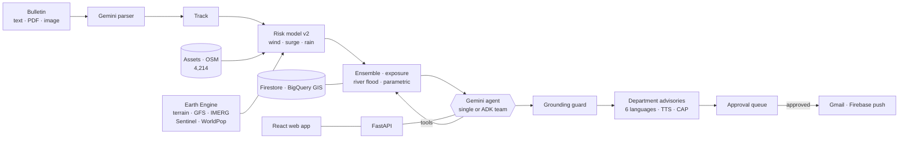
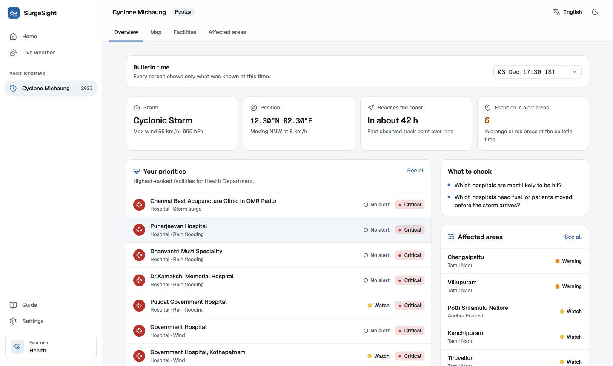
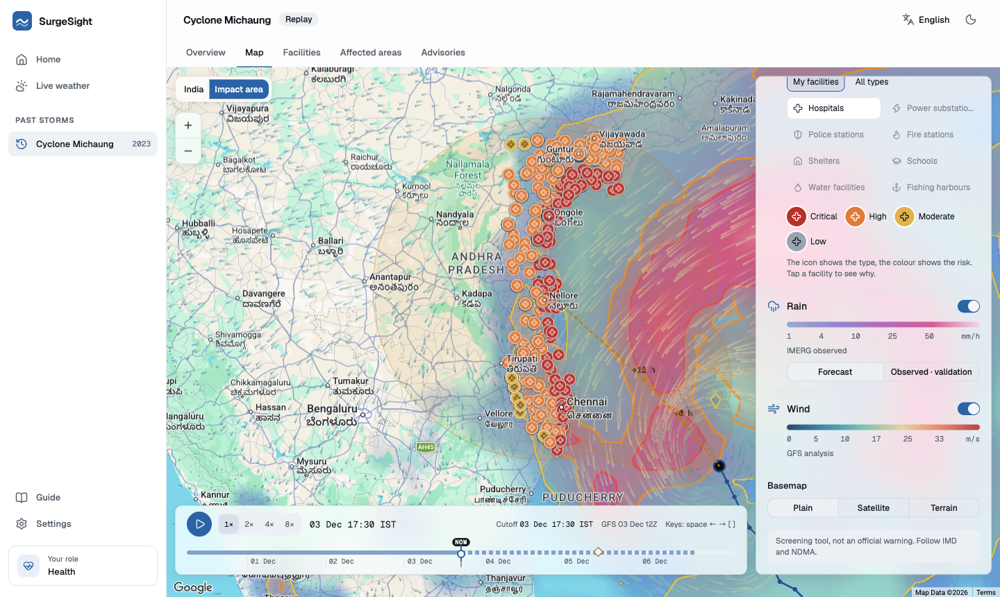
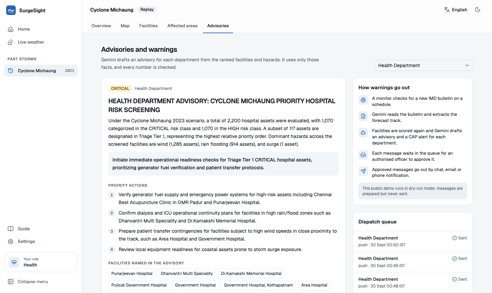

# SurgeSight

**From cyclone forecast to infrastructure consequence.** SurgeSight turns a cyclone bulletin into relative exposure screening for main roads and a ranked list of the hospitals, substations, shelters, fire and police stations, water works and harbours most likely to be hit. It lets an officer test "what if the track shifts 30 km north?", drafts a grounded advisory for each department in six languages, and queues alerts for human approval.

*Google Cloud × hack2skill · Build with AI: Code for Communities 2.0 · Problem Statement 05: Track-Based Cyclone Impact & Infrastructure Vulnerability Forecaster.*
*Demonstrated on Cyclone Michaung (December 2023, Tamil Nadu and Andhra Pradesh).*

> **Screening, not forecasting.** SurgeSight does not replace IMD. Every score is a screening index for prioritising attention, not a probability of damage. Experimental tracks are not official forecasts. Every alert is a CAP `Exercise` message and needs a human to approve it.

**Status:** working prototype, live on Cloud Run at https://surgesight-221627601364.asia-south1.run.app. See [Limitations](#responsible-use-and-limitations).

**Team Echo:** Charan and Vishal. **Demo video:** https://youtu.be/BeFNW2ZWFQM · **Pitch deck:** [`docs/pitch/SurgeSight_TeamEcho.pdf`](docs/pitch/SurgeSight_TeamEcho.pdf) · **Code:** https://gitlab.com/charanvelavan12/surgesight

## What it does

| Step | What happens |
|---|---|
| 1. Read | Gemini parses an IMD-style bulletin (text, PDF or image) into a structured track. |
| 2. Score | 4,214 assets and about 34,000 km of OSM motorway-to-tertiary roads are screened using modelled wind, storm surge, and rainfall on terrain. |
| 3. Test | A what-if simulator shifts the track or intensity. A 100-member ensemble, with spread taken from a measured track-error backtest, ranks assets by how often they reach HIGH or worse. |
| 4. Check | Results are compared with an independent NOAA GFS forecast, and validated against Sentinel-2 flood observations of the real event. |
| 5. Explain | A Gemini agent picks and runs the tools. A guard checks that **every number in its answer appears in a tool result**, and redacts any that do not. |
| 6. Act | Seven department views produce advisories (English, Tamil, Telugu, Hindi, Odia, Bengali) with audio, CAP 1.2 alerts, and illustrative parametric-insurance triggers. |
| 7. Approve | Nothing is sent without a person approving it. Delivery works by Gmail and by Firebase push. |

## Architecture



A fuller description, with design decisions, is in [`docs/ARCHITECTURE.md`](docs/ARCHITECTURE.md).

## Google technologies used

| Service | Job | State |
|---|---|---|
| **Gemini 3.7 Flash** (Vertex AI) | Orchestrator, bulletin parsing, advisories, translation, satellite-map review | Built |
| **Gemini Live API** (`gemini-3.8-live`) | Spoken question in, tool calls, spoken answer out | Built; tested with synthetic speech |
| **Agent Development Kit** | Incident Commander with forecast, impact, department, finance and comms agents | Built; not on Agent Engine |
| **Google Search grounding** | Latest bulletins and news with cited sources | Built |
| **Earth Engine** | Terrain, GFS forecast rain and winds, IMERG, Sentinel-1/2, WorldPop, Open Buildings, MERIT Hydro | Built |
| **Maps Platform** | Geocoding, Places, Routes (route exposure), Weather | Built |
| **Cloud Text-to-Speech / Speech-to-Text** | Spoken advisories and voice questions | Built (no Odia voice exists) |
| **Firestore** | Run store (`SURGESIGHT_STORE=firestore`) | Built |
| **BigQuery GIS** | Parameterised spatial asset queries | Built |
| **Gmail API** | Approved email dispatch with CAP attachment | Built, sent live |
| **Firebase Cloud Messaging** | Approved web push | Built, delivered live |
| **Cloud Run** (service and job), **Cloud Scheduler**, **Cloud Storage**, **Secret Manager** | Serves the API and web app; refreshes live weather every 3 hours | Built, deployed |
| **Firebase Hosting** | Front door that forwards to the Cloud Run service (`firebase.json`) | Configured |
| **Firebase Authentication** | Approver and viewer roles per department (`AUTH_MODE=firebase`) | Built |
| Pub/Sub, Looker Studio, Agent Engine | Event automation, dashboards, hosted ADK team | **Not built yet** |

Google Chat webhooks are coded but could not be tested: they are unavailable on personal accounts.

## Key results (Cyclone Michaung, one storm)

| Result | Value |
|---|---|
| Assets scored | 4,214 (3,977 core plus 237 department-layer assets) |
| Track forecast error (Kalman, backtest) | 27.6 km mean at 6 h, 48.2 km at 12 h |
| GFS vortex centre error vs observed | 44–80 km at +6 to +48 h; better than Kalman from +18 h |
| Satellite flood ranking, AUC (0.5 = no skill) | forecast rain 0.626 · v2 rain-flood 0.622 · river flood index 0.618 · v2 combined 0.554 · v2 wind **0.394** |
| Satellite coverage | Sentinel-2 saw 48.7% of assets; 11.5% of those showed flooding |
| Exposed people, top-priority footprint | 10.5 million (38.1% of the grid), triage tiers 1–2 |
| Parametric (illustrative) | 287.5 crore payout on the reference track of 490.0 crore insured |

**Honest reading.** Rainfall predicts flooding best; wind ranks flooded assets *below chance*. The v2 HIGH-or-worse class flags almost everything (hit rate 0.977, false-alarm rate 0.983) because the whole corridor was hit hard, so v2 also reports **relative triage tiers**. The model probably needs more rain weight and less wind and surge for flood impact. That change is not made yet.

## Quickstart

Requires Python 3.14, a Google Cloud project with Application Default Credentials (`gcloud auth application-default login`), and a `.env` (see below).

```bash
python -m venv .venv && source .venv/bin/activate
pip install -r requirements.txt
uvicorn api.main:app --port 8000     # API; docs at /docs, push test page at /push-test
python scripts/run_all_tests.py      # offline tests
python scripts/run_all_tests.py --live   # also calls Google APIs (uses quota or credit)
```

`.env` (never committed): `GOOGLE_CLOUD_PROJECT`, `GOOGLE_GENAI_USE_VERTEXAI=true`, `GOOGLE_CLOUD_LOCATION=global`, `GEMINI_API_KEY` (optional fallback), `GOOGLE_MAPS_API_KEY`, `DISPATCH_MODE=dry_run` (default; `live` sends only to `DISPATCH_ALLOWLIST`), `APPROVER_PASSCODE` (short-lived login mode for non-Cloud Run tests), `SMTP_HOST`, `SMTP_PORT`, `SMTP_USERNAME`, `SMTP_PASSWORD`, `SMTP_FROM` (or `SENDGRID_API_KEY` and `SENDGRID_FROM`) for real email dispatch, and the `FIREBASE_*` web settings.

## Web app

**Live:** https://surgesight-221627601364.asia-south1.run.app (Cloud Run, asia-south1)

A React app (`frontend/`) for district officials and emergency departments. The first visit asks for the user's role (District Collector, Health, Fire & Rescue, Electricity, Police, Water, Fisheries), language and theme. Every screen then puts that role's facilities first.

| Screen | What it shows |
|---|---|
| Home | Live weather over India, and past storms to replay |
| Overview | The storm at the chosen bulletin time, when it reaches the coast, the role's top facilities, affected districts and parametric payout triggers |
| Map | Alert zones, storm track and experimental forecast, storm surge, rain, wind particles and every facility, over a timeline that never shows what was not yet known |
| Facilities | The full ranked list, searchable; each row opens "Why is this critical?" (the numbers, then a short Gemini explanation checked against them) |
| Affected areas | Districts by alert level, with population and facilities |
| Roads | Relative road exposure by level, named roads to check, and facilities whose screened hospital access is at risk |
| Advisories | A Gemini advisory per department in the chosen language, with audio (Cloud Text-to-Speech), a CAP 1.2 alert, recipient management, and interactive dispatch controls to queue and approve alerts |
| Guide, Settings | Who uses which screen and how to read the map; role, theme, language, map defaults, saved data |

Six languages (English, Hindi, Tamil, Telugu, Bengali, Odia), light and dark themes, and a service worker that keeps the last data for weak connections.

```bash
uvicorn api.main:app --port 8000          # API (also serves frontend/dist when it has been built)
cd frontend && npm install && npm run dev  # http://localhost:5173  (set VITE_GOOGLE_MAPS_API_KEY and VITE_GOOGLE_MAP_ID in .env)
python scripts/build_weather_frames.py     # storm replay weather images from Earth Engine (cached)
python scripts/build_live_weather.py       # live weather images from the newest complete GFS run
python scripts/build_roads.py              # rebuild road outputs; Earth Engine samples resume from data/raw/road_samples.csv
python scripts/test_web.py                 # build, unit tests and a real-Chrome check of every screen
```





### Deployment

One Cloud Run service (`Dockerfile`) serves the API and the built web app from the same address. The live weather is rebuilt every 3 hours by the Cloud Run job `surgesight-live-refresh`, started by Cloud Scheduler, and published to Cloud Storage (`LIVE_BUCKET`); each instance picks up the newest copy. Gemini runs through Vertex AI under a dedicated service account; the Maps server key is in Secret Manager. Dispatch runs in dry-run mode on the public deployment.

```bash
npm --prefix frontend run build && gcloud run deploy surgesight --source . --region asia-south1
```

## Project layout

```
services/   models and integrations (risk, ensemble, hazards, agent, dispatch, cap, voice, maps)
api/        FastAPI wrappers over the services, including the streaming agent
frontend/   React web app: roles, overview, GPU weather map, facilities, areas, roads, advisories (see above)
config/     regions, departments, parametric triggers, CAP schema
scripts/    data builds and the test suite (each test prints a SURGESIGHT_*_OK marker)
docs/       architecture, the road method, screenshots and the pitch deck
```

## Responsible use and limitations

- **Screening indices only.** No damage, casualty, outage or road-status predictions. Road levels are relative within this storm: the top 5% of assessed km is always highlighted as most exposed.
- **One storm.** Calibration, the backtest and the validation all use Michaung. Nothing is validated out of sample. A second region (Fani 2019, Odisha) is planned but not built.
- **Satellite proxy.** Sentinel-1 radar did not image the area after landfall, so the flood flag comes from Sentinel-2 optical water mapping, which misses cloud-covered and urban flooding.
- **Data gaps.** OSM coverage of fire stations, water works and fishing harbours is thin. Live Google Weather shows today's conditions, not the 2023 event.
- **Parametric outputs are illustrative.** Portfolios, sums insured and payouts are invented.
- **Human in the loop.** Agents can queue a dispatch but never approve or send it. The default mode is a dry run.
- **Not built yet:** Pub/Sub event automation, Agent Engine, Looker Studio, and the storms after Michaung (Fani, Amphan, Biparjoy are listed in the app as coming).

## Data sources

NOAA IBTrACS and GFS, NASA GPM IMERG, Copernicus Sentinel-1/2, JRC Global Surface Water, USGS SRTM, WorldPop, Google Open Buildings, MERIT Hydro, FAO GAUL, OpenStreetMap contributors (ODbL), and Google Maps Platform. Places content is shown but never stored.

## Road method

The road model covers OpenStreetMap motorway, trunk, primary, secondary and tertiary roads (including link roads) in the Michaung study area, about 34,000 km. Rain and terrain use the same non-saturating interaction as the facility model; km-weighted percentiles assign the top 5% to “most exposed,” the next 15% to “high exposure,” and the next 30% to “watch.” Absolute IMD wind bands can raise a section's level. See [Road exposure](docs/ROAD_EXPOSURE.md) for validation and limits.

`roads_web.json.gz`, `road_access.csv` and `roads_summary.json` are committed for the deployed app. The 12 MB `road_sections.csv` is ignored; rebuild all road outputs with `.venv/bin/python scripts/build_roads.py` (cached Earth Engine samples make repeat builds fast).
