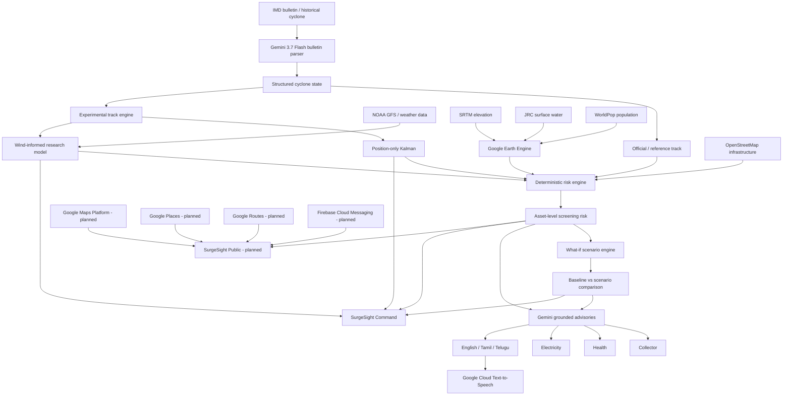

# SurgeSight

Track-Based Cyclone Impact, Infrastructure Vulnerability and Public Safety Intelligence

Build with AI: Code for Communities 2.0 — Google Cloud × hack2skill  
Problem Statement 05 — Track-Based Cyclone Impact & Infrastructure Vulnerability Forecaster  
Prototype deadline: 30 September 2026  
Current implementation focus: Cyclone Michaung 2023, Tamil Nadu / Andhra Pradesh

---

## 1. One-line idea

SurgeSight converts an official cyclone forecast into infrastructure-level consequences, lets authorities test how those consequences change if the forecast shifts, generates grounded department-specific actions with Gemini, and extends the same intelligence into a public-safety experience that helps citizens understand local risk, find nearby help, and choose lower-risk routes.

---

## 2. The problem

Cyclone forecasts are already produced by meteorological agencies such as IMD. The missing layer is often not another weather map.

The operational problem is:

> What does the forecast mean for the hospital, substation, road, shelter, district and community underneath the storm?

A forecast may say that a cyclone is moving north-northwest at a certain intensity and could make landfall near a particular coast. A district authority still has to answer:

- Which hospitals are likely to face the highest exposure?
- Which substations should be checked first?
- Which areas are low-lying and historically water-prone?
- How does the risk picture change if the track shifts by 20–30 km?
- Which facilities become newly vulnerable after a forecast update?
- What should the health department do compared with the electricity board?
- How should a warning be communicated in the local language?
- What should a citizen in a particular neighborhood actually do?
- Which nearby hospital or shelter should that citizen consider?
- Which route has lower modeled waterlogging exposure?

SurgeSight is designed to bridge the gap between:

```text
FORECAST
   ↓
CONSEQUENCE
   ↓
DECISION
   ↓
PUBLIC ACTION
```

---

## 3. Why SurgeSight

SurgeSight is not intended to replace IMD, numerical weather prediction, hydrodynamic storm-surge models, or official emergency agencies.

Its role is different:

```text
IMD / official forecast
        ↓
What is the cyclone expected to do?

SurgeSight
        ↓
What could that forecast mean for infrastructure and communities?

Authorities
        ↓
What should we prepare?

Citizens
        ↓
What should I avoid, where can I get help, and what should I do?
```

The project therefore focuses on anticipatory decision support rather than trying to become a new national weather forecasting agency.

---

## 4. Hackathon challenge

The selected challenge is Problem Statement 05: Track-Based Cyclone Impact & Infrastructure Vulnerability Forecaster.

The challenge asks for an AI-powered predictive risk and vulnerability platform using:

- Google Earth Engine satellite/geospatial feeds
- real-time meteorological data
- Gemini 3.7 Flash multimodal reasoning
- cyclone surge / rainfall pathway simulation
- critical-infrastructure exposure mapping
- automated early-warning advisories
- a functioning end-to-end prototype
- meaningful Google AI integration
- realistic or real data
- India-scale applicability
- multilingual or voice capability where appropriate

The hackathon evaluation weights are:

| Criterion | Weight |
|---|---:|
| AI / Technical Execution | 25% |
| Problem-Solution Fit | 20% |
| Depth & Reach Across India | 20% |
| Deployability & Scalability | 20% |
| Impact Potential | 15% |

---

## 5. Product vision: one intelligence core, two experiences

SurgeSight is evolving into two connected products powered by one common intelligence engine.

```text
                        SURGESIGHT INTELLIGENCE CORE

             Official forecast + environmental context
                              │
                              ▼
                   Geospatial risk computation
                              │
             ┌────────────────┴────────────────┐
             │                                 │
             ▼                                 ▼
       SURGESIGHT COMMAND                SURGESIGHT PUBLIC
       For authorities                   For citizens
```

### 5.1 SurgeSight Command

Primary users:

- District Collectors / District Disaster Management Authorities
- State Disaster Management Authorities
- Emergency Operations Centres
- Health Departments
- Electricity Boards
- Municipal / Corporation control rooms
- infrastructure operators

Questions it answers:

- What is at risk?
- Why is it at risk?
- What changed from the previous forecast?
- What if the track moves?
- What if intensity changes?
- Which hospitals/substations should be prioritized?
- What should my department prepare?
- How uncertain is the experimental trajectory?

### 5.2 SurgeSight Public

Primary users:

- residents in cyclone-affected areas
- travelers within an affected city/district
- families seeking emergency healthcare or shelter
- community volunteers

Questions it should answer:

- Am I currently inside a higher-risk area?
- What is the main local hazard?
- Where should I be careful?
- Which roads have higher modeled waterlogging exposure?
- What nearby hospital or shelter can I consider?
- Which candidate route has lower modeled hazard exposure?
- What is the official emergency number?
- Can I hear the warning in Tamil, Telugu or English?
- Can I receive an alert if my local risk changes?

The public product is planned as a simplified mobile/PWA-style experience. It will not expose research controls such as Kalman matrices, forecast model tuning, or raw geospatial scores.

---

# 6. Core design principle

The most important architectural decision in SurgeSight is:

```text
NUMBERS AND RISK
→ deterministic/geospatial models

LANGUAGE AND INTERPRETATION
→ Gemini
```

Gemini is deliberately not trusted to invent cyclone coordinates, calculate infrastructure risk, fabricate facility exposure, or decide whether an asset is critical.

This separation provides:

- reproducibility
- explainability
- testability
- lower hallucination risk
- clear auditability
- easier replacement of models later

For example:

```text
Hospital A

Distance to modeled track     → deterministic
Elevation                     → Earth Engine
Water occurrence              → Earth Engine
Wind exposure score           → deterministic
Terrain/flood score           → deterministic
Combined screening score      → deterministic

Narrative explanation         → Gemini
Department-specific actions   → Gemini, grounded in deterministic values
Tamil/Telugu/English wording  → Gemini
Voice alert                   → Google Cloud TTS
```

---

# 7. End-to-end workflow

## 7.1 Authority workflow

```text
1. Official bulletin / historical scenario
                    │
                    ▼
2. Gemini 3.7 Flash bulletin parser
                    │
                    ▼
3. Structured cyclone state
   - position
   - time
   - movement
   - wind
   - pressure
   - forecast points
   - landfall information
                    │
        ┌───────────┴───────────┐
        │                       │
        ▼                       ▼
4A. Official/reference     4B. Experimental
    trajectory                 trajectory
                               - Kalman
                               - wind-informed research model
        │                       │
        └───────────┬───────────┘
                    ▼
5. Environmental context
   - terrain
   - water occurrence
   - population
   - meteorological wind/rain where available
                    │
                    ▼
6. Infrastructure context
   - hospitals
   - substations
   - shelters
   - schools
   - major roads
                    │
                    ▼
7. Deterministic risk engine
                    │
                    ▼
8. LOW / MODERATE / HIGH / CRITICAL screening classes
                    │
                    ▼
9. What-if simulator
   - shift north/south
   - shift east/west
   - intensity ±%
                    │
                    ▼
10. Baseline vs scenario changes
                    │
                    ▼
11. Gemini grounded explanation
                    │
                    ▼
12. Department-specific actions
                    │
                    ▼
13. English / Tamil / Telugu
                    │
                    ▼
14. Google Cloud TTS
```

## 7.2 Public workflow

Planned:

```text
Citizen opens SurgeSight Public
              │
              ▼
Current location / selected locality
              │
              ▼
Local SurgeSight risk context
              │
       ┌──────┼──────────┐
       ▼      ▼          ▼
 waterlogging nearby   nearby
 risk         hospitals shelters
       │      │          │
       └──────┼──────────┘
              ▼
Google Maps + Places + Routes
              │
              ▼
Candidate routes
              │
              ▼
SurgeSight hazard-route intersection
              │
              ▼
"Lower modeled hazard exposure"
              │
              ▼
Call / navigate / hear warning / emergency 112
```

---

# 8. High-level architecture



---

# 9. Why each technology is used

## 9.1 Why IMD / an official meteorological source?

Google Earth Engine is not a replacement for an operational cyclone forecast.

The roles are different.

```text
IMD / official forecast
→ What is the storm forecast to do?

Earth Engine
→ What terrain, water history and population lie underneath it?
```

The official source provides the authoritative storm trajectory/intensity information.

Earth Engine contributes geospatial and environmental context.

The architecture deliberately allows official forecast products to be replaced or extended without replacing the exposure/risk/advisory system.

---

## 9.2 Why Google Earth Engine?

Earth Engine is used for scalable geospatial context rather than as the complete cyclone forecasting system.

Current datasets:

- USGS/SRTMGL1_003 — elevation
- JRC/GSW1_4/GlobalSurfaceWater — historical surface-water occurrence
- WorldPop/GP/100m/pop — population context

Benefits:

- consistent access across states
- avoids manually downloading huge raster datasets for every region
- suitable for national-scale expansion
- directly aligned with the challenge
- can later support historical validation using satellite observations

---

## 9.3 Why OpenStreetMap if Google Maps exists?

They serve different purposes in the current architecture.

OpenStreetMap currently provides a reproducible open infrastructure dataset for:

- hospitals
- schools
- shelters
- substations
- roads

Google Maps Platform is planned primarily as the polished visualization and citizen-interaction layer.

Future public mode can additionally use Google Places for nearby facilities and Google Routes for candidate navigation routes.

Therefore:

```text
OSM
→ infrastructure dataset / model input

Google Maps
→ visualization and interaction

Google Places
→ public-facing nearby facility discovery

Google Routes
→ route candidates / navigation context
```

---

## 9.4 Why Gemini?

Gemini is used where language and multimodal reasoning are genuinely useful.

Current responsibilities:

1. Parse unstructured cyclone bulletin text/PDF/image into a constrained schema.
2. Generate grounded role-specific operational narratives.
3. Translate/adapt advisories into English, Tamil and Telugu.
4. Explain deterministic what-if changes.
5. Explain experimental forecast differences without modifying model output.

Gemini does not calculate:

- asset risk scores
- track distances
- geodesic shifts
- terrain values
- risk classes
- scenario deltas
- experimental forecast coordinates

---

## 9.5 Why a deterministic risk model instead of training an ML model immediately?

A supervised damage model would ideally require a large, trustworthy dataset containing:

```text
cyclone conditions
+ flood depth
+ rainfall
+ wind
+ infrastructure properties
+ actual facility damage/failure
```

across many Indian cyclones.

We do not currently have that labeled dataset.

Training a model on invented labels would make the system look more "AI" while making the science weaker.

The present screening model is:

- transparent
- reproducible
- easy to inspect
- fast
- replaceable later by calibrated vulnerability functions or physics-based products

The risk score is a screening index.

A score of 0.78 does not mean "78% probability of damage."

---

# 10. Current data pipeline

## 10.1 Cyclone track

Historical prototype:

- Cyclone Michaung 2023
- NOAA IBTrACS
- 49 raw observations in the extracted track
- original-fix filtering is used in forecast backtesting to avoid interpolated future leakage

## 10.2 Terrain / water / population

Current Earth Engine analysis (clipped to India land pixels via LSIB) produced approximately:

| Metric | Current Michaung region result |
|---|---:|
| Mean elevation | 130.08 m |
| Low-lying land ≤ 10 m | 10.44% |
| Very-low land ≤ 5 m | 5.85% |
| Historical water-prone land | 5.72% |
| Population in analysis region | 27,876,776 |
| Mean terrain/flood screening index | 0.0858 |

Earlier versions of this table (mean elevation 78.60 m, 45.88% ≤ 10 m, 43.10% ≤ 5 m) included open-water pixels
that SRTM reports as 0 m. Those figures were corrected by the land mask (WP0.4). Asset-level terrain values are unaffected.

Important:

27,876,776 is population in the analysis region.

It is not yet a scientifically computed "population exposed" figure.

A true exposed-population figure requires intersection with a defined hazard footprint.

## 10.3 Infrastructure

Current processed infrastructure:

| Asset type | Count |
|---|---:|
| Hospitals | 2,200 |
| Emergency shelters | 195 |
| Schools | 1,211 |
| Substations | 371 |
| Critical assets total | 3,977 |
| Major road elements | 8,739 |

The OSM extraction uses resilient fallbacks and cached regional data because public Overpass endpoints proved unreliable for the large corridor.

---

# 11. Deterministic screening risk model

The current model combines:

- track distance
- cyclone wind intensity
- deterministic wind exposure decay
- elevation
- historical water occurrence
- terrain/flood screening score

Terrain attributes remain fixed when the cyclone track is shifted because the asset itself has not moved.

Current baseline classes across 3,977 assets:

| Risk class | Count |
|---|---:|
| LOW | 4 |
| MODERATE | 2,228 |
| HIGH | 1,737 |
| CRITICAL | 8 |

Current HIGH + CRITICAL examples:

- Hospitals: 950
- Substations: 147

These counts must be presented as prototype screening outputs, not verified damage probabilities.

The relatively large number of hospitals near the HIGH threshold is important because modest track shifts can produce large changes in class counts.

---

# 12. Gemini bulletin intelligence

Implemented.

Files:

```text
services/gemini_client.py
services/bulletin_parser.py
scripts/test_bulletin_parser.py
data/raw/sample_michaung_bulletin.txt
```

Model:

```text
gemini-3.7-flash
```

Supported input:

- pasted text
- TXT
- PDF
- PNG
- JPEG
- WebP
- HEIC / HEIF

Structured output:

```json
{
  "cyclone_name": "...",
  "bulletin_time": "...",
  "current_position": {
    "lat": null,
    "lon": null
  },
  "movement": {
    "direction": null,
    "speed_kmph": null
  },
  "maximum_sustained_wind_kmph": null,
  "gust_kmph": null,
  "central_pressure_hpa": null,
  "forecast_track": [],
  "landfall": {
    "location_text": null,
    "expected_time": null,
    "confidence_text": null
  },
  "rainfall_summary": null,
  "warnings": []
}
```

Rules:

- unavailable information becomes null
- coordinates are never invented
- wind/pressure are never invented
- forecast and observed points must remain distinct
- uncertainty wording is preserved

Live parser validation:

```text
SURGESIGHT_BULLETIN_PARSER_OK
```

Test extraction from the synthetic Michaung sample correctly returned:

- Cyclone: MICHAUNG
- bulletin time: 1200 UTC, 04 December 2023
- position: 14.0 N, 80.6 E
- wind: 101.86 km/h
- pressure: 986 hPa
- three forecast points
- unavailable gust/landfall/rainfall/warnings remained null/empty

The sample bulletin is clearly labeled synthetic and derived only from existing historical track information.

---

# 13. Grounded department advisories

Implemented.

File:

```text
services/advisory.py
```

Roles:

- District Collector / Disaster Management
- Health Department
- Electricity Board

Languages:

- English
- Tamil
- Telugu

Gemini receives only selected deterministic context relevant to the audience.

Examples:

```text
Health
→ high-risk hospitals

Electricity
→ high-risk substations

Collector
→ overall asset context, hospitals, shelters and wider operational picture
```

Gemini is not trusted to calculate severity, asset score, distance, or asset identity.

Critical deterministic fields are enforced after generation before display.

Example tested Health Department output:

- severity: CRITICAL
- high/critical hospitals: 950
- included deterministic facility examples
- actions covered contingency planning, staffing, communication, supplies and facility readiness
- explicitly stated that road access had not been scored
- included prototype/non-official disclaimer

Live English, Tamil and Telugu generation tests passed.

---

# 14. Voice alerts

Implemented.

File:

```text
services/tts.py
```

Technology:

- Google Cloud Text-to-Speech
- service-account impersonation / token-based access
- no downloaded service-account JSON key required

A live English synthesis test generated a valid MP3.

Tamil/Telugu codes are implemented but were not all synthesized during validation.

Current use:

```text
Department advisory
        ↓
Local language
        ↓
Play community alert
```

Future use:

- public warning audio
- community radio
- control room playback
- IVR/loudspeaker integration

---

# 15. What-If Forecast Simulator

Implemented and validated.

Files:

```text
services/risk_model.py
services/scenario_engine.py
services/scenario_explainer.py
scripts/test_scenario_engine.py
```

The original scoring formulas were centralized into `risk_model.py`.

The baseline risk logic did not change.

Supported controls:

```text
North / South track shift    -50 km to +50 km
East / West track shift      -50 km to +50 km
Cyclone intensity            -20% to +20%
```

A +30 km North preset is included for the demo.

Track shifting uses WGS84 geodesic displacement.

The scenario engine recomputes:

- distance to track
- nearest-track wind
- wind score
- combined risk score
- risk class

It does not recompute static terrain values.

Baseline equivalence test:

```text
SURGESIGHT_SCENARIO_BASELINE_MATCH_OK
```

All 3,977 assets matched the original scoring pipeline exactly for:

- distance
- nearest-track wind
- wind score
- terrain/flood score
- combined score
- class

## 15.1 +30 km North result

Validation:

```text
SURGESIGHT_SCENARIO_30KM_OK
```

| Metric | Baseline | +30 km North |
|---|---:|---:|
| Critical assets | 8 | 4 |
| High + Critical assets | 1,745 | 1,286 |
| Hospitals High+ | 950 | 684 |
| Substations High+ | 147 | 126 |

Localized transitions:

- newly HIGH: 47
  - hospitals: 18
  - schools: 27
  - substations: 2
- newly CRITICAL: 2
  - both schools
- assets with increased risk: 942
- assets with decreased risk: 3,010
- no longer High+: 506
- unchanged: 25

Simulation runtime:

```text
0.0383 seconds
```

This is a major differentiator because SurgeSight can answer:

> What changes operationally if the track shifts?

rather than only displaying a static hazard map.

---

# 16. Experimental cyclone trajectory model

Implemented and backtested.

This is explicitly labeled:

```text
SurgeSight Experimental Track Forecast
Not an official meteorological forecast.
```

It does not replace IMD.

Files:

```text
services/wind_provider.py
services/track_forecaster.py
services/track_forecast_explainer.py
scripts/backtest_track_forecast.py
scripts/generate_experimental_track.py
scripts/test_track_forecaster.py
```

## 16.1 Position-only Kalman baseline

State:

```text
[x, y, vx, vy]
```

Concept:

```text
recent original cyclone fixes
        ↓
estimate position + velocity
        ↓
constant-velocity Kalman prediction
        ↓
6 h / 12 h / 24 h experimental trajectory
```

The filter uses:

- local projected coordinates
- Joseph-form covariance update
- approximately 15 km assumed position-fix uncertainty
- process noise that allows velocity to drift

## 16.2 Wind-informed research model

Environmental wind source used for the Michaung replay:

- NOAA GFS 0.25° archived analyses
- accessed through Open-Meteo Historical Forecast API
- 850 hPa
- 500 hPa
- 200 hPa
- u/v components
- cached locally after download

Steering flow:

```text
0.45 × 850 hPa
+ 0.35 × 500 hPa
+ 0.20 × 200 hPa
```

To reduce contamination from the cyclone's own circulation, environmental wind is sampled in a 300–600 km ring around the center.

The wind-informed model relaxes cyclone velocity toward a derived steering vector plus an experimental beta-drift term.

The parameters were not tuned on Michaung after seeing the test results.

## 16.3 Data leakage controls

IBTrACS contains interpolated rows.

The forecaster only uses original fixes for backtesting.

For each historical cutoff:

- only observations at or before cutoff are visible
- predictions remain identical even if the full future track file is supplied
- wind data is cutoff-constrained
- future wind requests raise an error

This is important because otherwise the backtest could unknowingly contain future information.

## 16.4 Historical Michaung backtest

Valid cases:

```text
6 h  → 22
12 h → 21
24 h → 19
```

Mean error:

| Model | 6 h | 12 h | 24 h |
|---|---:|---:|---:|
| Position-only Kalman | 27.6 km | 48.2 km | 106.4 km |
| Wind-informed | 27.9 km | 52.8 km | 127.4 km |

Median error:

| Model | 6 h | 12 h | 24 h |
|---|---:|---:|---:|
| Position-only Kalman | 25.4 km | 46.0 km | 109.7 km |
| Wind-informed | 30.4 km | 52.1 km | 122.0 km |

RMSE:

| Model | 6 h | 12 h | 24 h |
|---|---:|---:|---:|
| Position-only Kalman | 30.8 km | 51.5 km | 114.3 km |
| Wind-informed | 31.0 km | 54.7 km | 132.3 km |

p90:

| Model | 6 h | 12 h | 24 h |
|---|---:|---:|---:|
| Position-only Kalman | 46.8 km | 70.3 km | 161.9 km |
| Wind-informed | 42.7 km | 64.3 km | 180.3 km |

Validation markers:

```text
SURGESIGHT_TRACK_FORECASTER_OK
SURGESIGHT_TRACK_BACKTEST_OK
```

## 16.5 Important result: wind did not improve the model

The wind-informed model was:

- about 0.4 km worse in mean error at 6 h
- about 4.7 km worse at 12 h
- about 21.0 km worse at 24 h

It had a lower p90 at 6 h and 12 h, but worse average performance overall.

This result is kept rather than hidden or tuned away.

Why it likely lost:

- Michaung slowed and turned north near the coast
- steering was frozen at forecast cutoff
- the experimental northwest drift could push the track inland
- one storm is far too little data for tuning
- the model does not contain complete cyclone physics or forecast atmospheric evolution

Current product decision:

```text
IMD / official forecast
→ authoritative

Position-only Kalman
→ experimental short-term scenario aid

Wind-informed model
→ research comparison, not primary trajectory
```

The public app should not use the experimental trajectory to issue public safety alerts.

---

# 17. Forecast uncertainty

The experimental model reports a 90% uncertainty ellipse derived from predicted position covariance.

Current limitation:

- all verifying points fell inside the nominal 90% ellipse
- this indicates the uncertainty model is too conservative
- the current process-noise model is nearly directionally symmetric, so ellipses are not yet physically rich

Future improvement:

- calibrate uncertainty using many cyclones
- use anisotropic process noise
- use forecast winds rather than frozen analysis
- explore ensemble / particle / UKF methods only after enough validation data exists

---

# 18. Experimental-track infrastructure impact

At the selected historical cutoff:

```text
2023-12-03 12:00 UTC
```

the track up to cutoff + 24 h was scored through the same deterministic risk engine.

| Metric | Observed/reference | Kalman | Wind-informed |
|---|---:|---:|---:|
| High+ assets | 1,295 | 86 | 943 |
| Critical | 0 | 0 | 3 |
| High+ hospitals | 588 | 24 | 452 |
| High+ substations | 123 | 26 | 108 |

At that cutoff:

- Kalman 24 h track error: 72.7 km
- wind-informed 24 h track error: 93.2 km

This demonstrates an important operational fact:

Small or moderate track errors can cause large infrastructure-count changes when many assets lie close to a risk threshold.

Therefore the UI must show uncertainty and must not imply that a single experimental trajectory is certain.

---

# 19. SurgeSight Command user experience

The authority interface should follow five questions.

```text
1. UNDERSTAND
   What is the cyclone doing?

2. SEE CONSEQUENCES
   What assets are exposed?

3. COMPARE
   What changed?

4. SIMULATE
   What if the track/intensity changes?

5. ACT
   What should my department do?
```

Target final navigation:

```text
Overview
Impact Map
Forecast Simulator
Experimental Forecast
Department Actions
Alerts
```

The interface should not be organized around developer technologies such as:

```text
Gemini
Kalman
OSM
Earth Engine
```

Those are implementation details.

---

# 20. SurgeSight Public — planned citizen experience

This is now a major planned extension because the project should close the loop from government intelligence to meaningful citizen action.

Proposed home screen:

```text
SURGESIGHT PUBLIC

Your Area
Chennai

Local Risk
HIGH

Main concerns
Waterlogging
Strong winds

Expected higher-risk period
6 PM – 11 PM

Nearby lower-risk hospital
2.4 km

Nearby shelter
4.1 km

[ Find lower-risk route ]
[ Call 112 ]
[ Listen in Tamil ]
[ Alert me if risk changes ]
```

## 20.1 Public risk

The public interface should present categories such as:

```text
LOW
MODERATE
HIGH
CRITICAL
```

It should not currently claim precise water depth such as:

```text
42 cm water
```

because SurgeSight does not yet run a calibrated urban hydrodynamic model.

Allowed wording:

```text
High modeled waterlogging susceptibility
Low elevation
Heavy rainfall context
Historical water occurrence
```

Future calibrated flood-depth modelling can replace or augment this.

## 20.2 Nearby hospitals

Planned Google Places integration can support:

- nearby hospitals
- place details
- address
- phone number where available
- navigation handoff
- opening information where available

SurgeSight should not claim:

```text
ICU available
beds available
doctor available
```

unless an official live health-system feed is integrated.

The app should instead say:

```text
Nearby lower-risk hospital
```

rather than:

```text
Best hospital with guaranteed capacity
```

## 20.3 Safer-route concept

Planned flow:

```text
Current location
      ↓
Google Routes candidate routes
      ↓
SurgeSight hazard layers
      ↓
intersect route geometry with modeled risk
      ↓
compare candidate routes
      ↓
show lower modeled hazard exposure
```

Example:

```text
Route A
12 min
2.1 km through HIGH modeled waterlogging risk

Route B
16 min
0.2 km through MODERATE risk

Route C
20 min
no HIGH segment in current screening layer
```

The app should say:

```text
Lower modeled hazard exposure
```

not:

```text
Guaranteed safe route
```

because field conditions may change faster than the model.

## 20.4 Emergency

Planned public mode:

```text
Emergency
CALL 112
```

The app can also provide hospital contact buttons when a verified number is available.

## 20.5 Public notifications

Prototype plan:

```text
SurgeSight backend
      ↓
Firebase Cloud Messaging
      ↓
location/topic-based push notification
```

Example:

```text
Your selected area changed from MODERATE to HIGH waterlogging risk.
Review nearby shelters and avoid higher-risk corridors.
```

Long-term government deployment can expose CAP-compatible warnings to authorized emergency alerting channels.

SurgeSight should not claim that the hackathon prototype can directly publish arbitrary alerts into Google Public Alerts.

---

# 21. Why Google Maps for the final UI

The current Streamlit/PyDeck UI was chosen for speed during the hackathon.

It allowed the team to prove the core system before spending time on frontend engineering.

The desired final web architecture is:

```text
Next.js + TypeScript
        │
        ▼
Google Maps JavaScript API
        │
        ├── official track
        ├── experimental track
        ├── uncertainty
        ├── infrastructure
        ├── risk transitions
        ├── hazard overlays
        └── citizen route context
        │
        ▼
FastAPI / Python backend
```

Planned use of Google Maps ecosystem:

```text
Google Maps
→ basemap / interaction

Google Places
→ citizen facility discovery

Google Routes
→ candidate routes / travel context

Firebase Cloud Messaging
→ public push alerts
```

A WebGL overlay such as deck.gl can still be used on top of Google Maps for high-volume custom visualization.

The choice is therefore not necessarily:

```text
Google Maps OR deck.gl
```

but:

```text
Google Maps + specialized data overlays
```

---

# 22. Why not Flutter immediately?

Flutter remains useful for a future mobile public application.

For the hackathon:

```text
Streamlit
→ fastest prototype

Next.js + TypeScript
→ preferred polished command/public web application

Flutter
→ future native/mobile public client if needed
```

A frontend rewrite should happen only after:

- backend logic is frozen
- deployment is stable
- core demo works
- submission assets are safe

A polished unfinished UI is less valuable than a fully functional end-to-end prototype.

---

# 23. Current Streamlit application

Current tabs/features include:

## Bulletin Intelligence

- paste bulletin text
- upload TXT/PDF/image
- Gemini structured extraction
- forecast-track table
- landfall and warning fields
- raw JSON

## Risk / infrastructure visualization

- historical track
- risk-scored infrastructure
- generated metrics
- map tooltips

## Role-specific advisories

- Collector
- Health
- Electricity
- English
- Tamil
- Telugu
- deterministic critical-asset table
- raw advisory JSON
- TTS

## Forecast Simulator

- N/S geodesic shift
- E/W geodesic shift
- intensity adjustment
- +30 km north preset
- baseline vs scenario
- newly-at-risk table
- map comparison
- Gemini grounded explanation

## Experimental Track Forecast

- historical cutoff selector
- 6/12/24 h horizon
- reference track
- Kalman track
- wind-informed research track
- uncertainty ellipse
- backtest table
- infrastructure impact comparison
- grounded Gemini explanation

Headless app validation has passed without runtime errors.

---

# 24. Current repository structure

Representative structure:

```text
SurgeSight/
│
├── app.py
│
├── services/
│   ├── gemini_client.py
│   ├── bulletin_parser.py
│   ├── advisory.py
│   ├── tts.py
│   ├── risk_model.py
│   ├── scenario_engine.py
│   ├── scenario_explainer.py
│   ├── wind_provider.py
│   ├── track_forecaster.py
│   └── track_forecast_explainer.py
│
├── scripts/
│   ├── build_michaung_terrain.py
│   ├── fetch_osm_infrastructure.py
│   ├── score_infrastructure_risk.py
│   ├── analyze_risk_distribution.py
│   ├── test_bulletin_parser.py
│   ├── test_scenario_engine.py
│   ├── backtest_track_forecast.py
│   ├── generate_experimental_track.py
│   └── test_track_forecaster.py
│
├── data/
│   ├── raw/
│   │   ├── sample_michaung_bulletin.txt
│   │   └── wind/
│   │
│   └── processed/
│       ├── michaung_track.csv
│       ├── michaung_terrain_summary.json
│       ├── scored_assets.csv
│       ├── risk_diagnostics.json
│       ├── scenario_assets.csv
│       ├── scenario_assets.geojson
│       ├── scenario_summary.json
│       ├── track_backtest.csv
│       ├── track_backtest.json
│       ├── experimental_track_kalman.geojson
│       ├── experimental_track_wind.geojson
│       └── experimental_track_summary.json
│
└── README.md
```

---

# 25. Current validation markers

```text
SURGESIGHT_EARTH_ENGINE_OK
SURGESIGHT_GEMINI_OK
SURGESIGHT_BULLETIN_PARSER_OK
SURGESIGHT_SCENARIO_BASELINE_MATCH_OK
SURGESIGHT_SCENARIO_30KM_OK
SURGESIGHT_SCENARIO_EXPLANATION_OK
SURGESIGHT_TRACK_FORECASTER_OK
SURGESIGHT_TRACK_BACKTEST_OK
SURGESIGHT_FINAL_APPTEST_OK
```

---

# 26. Run commands

Activate environment:

```bash
source .venv/bin/activate
```

Terrain:

```bash
python scripts/build_michaung_terrain.py
```

Infrastructure:

```bash
python scripts/fetch_osm_infrastructure.py
```

Risk:

```bash
python scripts/score_infrastructure_risk.py
```

Diagnostics:

```bash
python scripts/analyze_risk_distribution.py
```

Gemini parser test:

```bash
python scripts/test_bulletin_parser.py
```

Scenario validation:

```bash
python scripts/test_scenario_engine.py
```

Track forecaster tests:

```bash
python scripts/test_track_forecaster.py
```

Track backtest:

```bash
python scripts/backtest_track_forecast.py
```

Generate experimental track:

```bash
python scripts/generate_experimental_track.py
```

Run application:

```bash
streamlit run app.py
```

Without activating the environment:

```bash
.venv/bin/python scripts/test_scenario_engine.py
.venv/bin/python scripts/test_track_forecaster.py
.venv/bin/streamlit run app.py
```

---

# 27. Google Cloud / Google AI stack currently configured

Project ID:

```text
gen-lang-client-0679887739
```

Enabled / validated components include:

- Gemini API
- Google Earth Engine
- Google Cloud Text-to-Speech
- Cloud Run API
- Cloud Build API
- Artifact Registry API
- IAM Service Account Credentials API

Gemini model:

```text
gemini-3.7-flash
```

TTS service identity:

```text
surgesight-dev@gen-lang-client-0679887739.iam.gserviceaccount.com
```

Secrets must never be committed.

Expected local environment pattern:

```text
GEMINI_API_KEY=...
```

Use `.env` locally and keep it in `.gitignore`.

Do not commit:

- Gemini keys
- OAuth tokens
- downloaded service-account JSON keys
- billing credentials

---

# 28. Google technology roles

| Google technology | SurgeSight role | Status |
|---|---|---|
| Gemini 3.7 Flash | multimodal bulletin parsing | Implemented |
| Gemini 3.7 Flash | grounded advisories | Implemented |
| Gemini 3.7 Flash | scenario explanations | Implemented |
| Gemini 3.7 Flash | experimental forecast explanation | Implemented |
| Google Earth Engine | elevation / water / population context | Implemented |
| Cloud Text-to-Speech | voice alerts | Implemented |
| Cloud Run | deployment | Pending |
| Google Maps Platform | final command/public map | Planned |
| Google Places | nearby public facilities | Planned |
| Google Routes | candidate routes | Planned |
| Firebase Cloud Messaging | citizen notifications | Planned |
| CAP integration | standards-based authority warning output | Planned |

---

# 29. How SurgeSight stands out

## 29.1 It does not stop at a red cyclone map

Typical:

```text
cyclone
→ hazard map
```

SurgeSight:

```text
cyclone forecast
→ asset consequences
→ changed scenario
→ department action
→ public action
```

## 29.2 It separates calculation from language AI

```text
deterministic model
→ risk

Gemini
→ understanding and communication
```

This makes the AI useful without allowing it to silently fabricate critical numbers.

## 29.3 It supports forecast uncertainty and what-if changes

```text
What if landfall shifts 30 km north?
```

Risk is actually recomputed for all assets.

Gemini only explains the resulting changes.

## 29.4 It has measured experimental forecasting

The Kalman and wind-informed tracks are not decorative lines.

They were historically replayed and measured against later IBTrACS fixes.

The project even preserves a negative research result: wind steering did not outperform the simpler Kalman model on Michaung.

## 29.5 It targets different departments

The same cyclone produces different operational views for:

- disaster management
- healthcare
- electricity

## 29.6 It closes the loop to citizens

Planned public mode turns the authority intelligence into:

- local risk
- nearby help
- lower-risk candidate routes
- local-language audio
- emergency access
- push notifications

---

# 30. Scientific honesty and limitations

SurgeSight is a prototype decision-support system.

It must not be represented as an operational replacement for IMD or national disaster authorities.

Current limitations:

1. The risk model is a screening model.
2. The surge/flood component is not a full hydrodynamic storm-surge model.
3. Current waterlogging output is susceptibility, not calibrated flood depth.
4. Road access is not yet modeled as a complete network graph.
5. OSM infrastructure coverage can be incomplete.
6. OSM schools are not automatically official evacuation shelters.
7. Population in analysis region is not equivalent to exposed population.
8. The Kalman forecaster is an experimental short-term model.
9. The wind-informed model did not outperform Kalman on the Michaung backtest.
10. One cyclone is insufficient to establish general forecast skill.
11. Experimental uncertainty is currently over-conservative.
12. Department recommendations still require human review.
13. Public route recommendations can only indicate lower modeled exposure, never guarantee safety.
14. Hospital availability cannot be claimed without an official live hospital-capacity feed.
15. The current prototype does not directly publish to official cell-broadcast / Google Public Alerts infrastructure.

---

# 31. What a future research-grade system would add

Long-term architecture:

```text
Official forecast ensembles
        +
NWP wind / pressure / rainfall
        +
physics-based surge
        +
rainfall-runoff model
        +
drainage / flood-depth model
        +
asset vulnerability curves
        +
road-network graph
        +
infrastructure dependencies
        ↓
probabilistic impact model
        ↓
SurgeSight decision layer
```

Major future improvements:

## Vulnerability curves

Instead of generic screening weights:

```text
hazard × exposure × vulnerability
→ damage/failure likelihood
```

with different functions for:

- hospitals
- substations
- roads
- schools
- shelters

## Forecast ensembles

Instead of one experimental track:

```text
50 plausible tracks
        ↓
asset appears HIGH in 41 / 50
```

This can support probabilistic exposure.

## Road graph

Model roads as a network.

Questions:

- Can an ambulance still reach Hospital A?
- Are all routes to a shelter intersecting flooded segments?
- Which bridge/road failure disconnects the largest population?

## Cascading infrastructure failure

Example:

```text
Substation A fails
      ↓
Hospital A power dependency
Hospital B power dependency
Shelter C communications
```

## Historical validation

Compare pre-landfall SurgeSight risk against:

- observed flooding
- satellite rainfall
- documented power outages
- road disruptions
- officially reported damage

across multiple cyclones.

---

# 32. India-scale plan

Initial full prototype:

```text
Michaung 2023
Tamil Nadu / Andhra Pradesh
```

Planned historical expansion:

| Cyclone | Year | Region |
|---|---:|---|
| Fani | 2019 | Odisha |
| Amphan | 2020 | West Bengal |
| Michaung | 2023 | Tamil Nadu / Andhra Pradesh |
| Biparjoy | 2023 | Gujarat |

Expansion should be configuration-driven.

A new state should primarily require:

- region boundary
- cyclone input
- local language configuration
- infrastructure refresh
- environmental preprocessing

rather than a new codebase.

---

# 33. Cross-border applicability

The core architecture is not India-specific.

Relevant global datasets include:

- IBTrACS
- Earth Engine datasets
- OpenStreetMap
- global weather products

The model can eventually be configured for other cyclone-prone regions while official meteorological and emergency agencies remain authoritative within each jurisdiction.

---

# 34. Deployment architecture

## Current development architecture

```text
Local Python
   │
   ├── Streamlit
   ├── Gemini API
   ├── Earth Engine
   ├── local processed data
   └── Cloud TTS
```

## Hackathon deployment target

```text
Browser
   │
   ▼
Cloud Run
   │
   ├── Streamlit application
   ├── Gemini
   ├── TTS
   └── precomputed scenario data
```

Heavy geospatial work should stay precomputed/cached where practical.

Why:

- faster demo
- fewer external failures
- reduced Overpass dependency
- predictable runtime
- lower cost
- easier scaling

## Desired post-hackathon architecture

```text
                 Next.js / TypeScript
                  Google Maps UI
                       │
                       ▼
                    FastAPI
                       │
       ┌───────────────┼────────────────┐
       ▼               ▼                ▼
Risk / scenario     Gemini layer    Public safety APIs
Python engine                        Places / Routes / FCM
       │
       ▼
Cached geospatial data / Earth Engine
```

---

# 35. Evaluation-criteria alignment

## 35.1 AI / Technical Execution — 25%

Current evidence:

- live Gemini 3.7 Flash multimodal/structured parser
- schema validation
- grounded department advisories
- three languages
- Google TTS
- deterministic risk separation
- deterministic what-if simulator
- historical Kalman backtest
- negative wind-model result honestly retained
- Earth Engine integration
- end-to-end Streamlit app

Remaining to maximize:

- deployed Cloud Run URL
- polished live user journey
- potentially final Google Maps/public flow

## 35.2 Problem-Solution Fit — 20%

Strong current fit:

```text
cyclone bulletin
→ track
→ hazard/exposure
→ critical infrastructure
→ early actions
```

The public layer strengthens the final impact pathway but is not required for the core authority challenge.

## 35.3 Depth & Reach Across India — 20%

Current:

- full technical implementation centered on Michaung
- Tamil/Telugu/English advisories
- data architecture is reusable

Remaining:

- second cyclone/state demonstration
- ideally Fani/Odisha or another geographically different case
- additional language only if time remains

## 35.4 Deployability & Scalability — 20%

Current strengths:

- serverless-compatible
- cached preprocessing
- no custom hardware
- open/global datasets
- deterministic modular backend

Remaining:

- Cloud Run deployment
- environment/secrets hardening
- public API separation if the frontend is upgraded
- CAP export if time permits

## 35.5 Impact Potential — 15%

Current:

- thousands of real infrastructure assets
- departmental action generation
- local-language voice
- scenario changes

Planned public layer adds:

- neighborhood-level awareness
- nearby hospitals/shelters
- lower-risk route comparison
- emergency access
- push notifications

---

# 36. Current completion status

There are two useful ways to measure completion.

## 36.1 Core technical prototype

Estimated completion:

```text
~85%
```

Why this is high:

- geospatial preprocessing works
- infrastructure extraction works
- deterministic risk scoring works
- bulletin AI works
- advisories work
- multilingual works
- TTS works
- scenario simulator works
- experimental track model works
- backtesting works
- app integration works

The core intelligence engine is already largely complete.

## 36.2 Submission-ready product

Estimated completion:

```text
~65%
```

This is lower because a hackathon submission is not only the model.

Important remaining work includes:

- cloud deployment
- public-safety experience
- second geographic scenario
- UI polish / possible Google Maps frontend
- CAP output if feasible
- exposed-population calculation if feasible
- demo video
- pitch deck
- final README/repository cleanup
- screenshots
- final test pass
- deployed link

These percentages are internal project-readiness estimates, not judge scores.

---

# 37. Detailed completed vs remaining matrix

| Workstream | Status | Approx. readiness |
|---|---|---:|
| Gemini bulletin parser | Complete | 100% |
| Earth Engine setup | Complete | 100% |
| Michaung terrain preprocessing | Complete | 100% |
| OSM infrastructure pipeline | Complete | 100% |
| Deterministic risk engine | Complete | 100% |
| Risk diagnostics | Complete | 100% |
| Gemini department advisories | Complete | 100% |
| English/Tamil/Telugu | Complete | 100% |
| Cloud TTS | Complete for prototype | 90% |
| What-if scenario simulator | Complete | 100% |
| Scenario Gemini explanation | Complete | 100% |
| Position-only Kalman forecast | Complete | 100% |
| Wind-informed research model | Complete | 100% |
| Historical forecast backtest | Complete for Michaung | 100% |
| Streamlit integrated UI | Working | 90% |
| Second cyclone/state | Pending | 0% |
| Cloud Run deployment | Pending | 0% |
| Google Maps polished frontend | Planned | 0% |
| SurgeSight Public | Planned | 0% |
| Google Places hospitals | Planned | 0% |
| Google Routes hazard comparison | Planned | 0% |
| Firebase push alerts | Planned | 0% |
| CAP output | Planned | 0% |
| True hazard-footprint population exposure | Pending | 0% |
| Road graph / access analysis | Future | 0% |
| Historical damage validation | Future / stretch | 0% |
| Pitch deck | Pending | 0% |
| Demo video | Pending | 0% |
| Final deployed URL | Pending | 0% |

---

# 38. What should be built next

Because the deadline is extremely close, priority must be based on demo value and submission risk.

## Priority 1 — freeze and deploy the working command prototype

Before major new work:

- make current tests green
- create `.gitignore`
- freeze dependencies
- verify secrets
- deploy to Cloud Run
- confirm public URL works

A deployed working application is a submission requirement and should not be risked for optional UI work.

## Priority 2 — implement a minimal SurgeSight Public page

Do not build a huge mobile app.

Minimum useful public MVP:

1. select/simulate current location
2. show local modeled risk
3. show nearby hospitals/shelters
4. show 112 button
5. language selector
6. local-language TTS
7. optionally show a candidate lower-risk route

This can initially live inside the same Streamlit app.

## Priority 3 — second geography

Add one second scenario to prove transferability.

Preferred:

```text
Fani → Odisha
```

It does not need every advanced feature.

It needs enough to prove:

```text
same architecture
different state
different cyclone
```

## Priority 4 — Google Maps / Next.js only if safe

If the backend is deployed and the demo is secure, then consider:

```text
Next.js + TypeScript + Google Maps
```

Otherwise polish Streamlit.

Do not lose a working application to a last-minute frontend rewrite.

## Priority 5 — submission package

- 3–5 minute video
- 10–12 slide pitch
- 2–3 line project description
- GitHub cleanup
- screenshots
- deployed URL

---

# 39. Recommended final demo story

Target: approximately 3:30–4:00 minutes.

## 0:00–0:20 — Problem

> Cyclone forecasts tell authorities where a storm may go, but they do not immediately tell a district collector which hospital, substation or community needs attention first.

## 0:20–0:40 — SurgeSight

> SurgeSight converts cyclone forecasts into infrastructure-level anticipatory action.

## 0:40–1:05 — Bulletin intelligence

Upload/paste cyclone bulletin.

Show Gemini extracting:

- position
- wind
- pressure
- track

## 1:05–1:35 — Impact

Show real infrastructure on the map.

Click an asset and show why it is flagged.

Explain:

> Gemini did not calculate this risk. The risk comes from the deterministic geospatial engine using the forecast, Earth Engine context and infrastructure data.

## 1:35–2:05 — What-if

Choose:

```text
+30 km North
```

Click simulate.

Show:

- changed totals
- newly high-risk facilities
- assets becoming safer
- 0.038 s simulation

## 2:05–2:25 — Experimental forecasting

Show:

- official/reference track
- Kalman experimental track
- uncertainty
- historical backtest

Say clearly:

> We also tested a wind-informed model. It did not improve the historical Michaung mean error, so we do not claim it is better.

This is a credibility moment.

## 2:25–2:50 — Department actions

Switch:

```text
Health Department
```

Show grounded action list.

Switch language:

```text
Tamil
```

Play TTS.

## 2:50–3:25 — Public safety

Show planned/working public view:

```text
My area
Risk
Nearby help
Emergency
Lower-risk route
```

## 3:25–3:45 — Scale

Show:

```text
Michaung → Tamil Nadu/AP
Fani → Odisha
Amphan → West Bengal
Biparjoy → Gujarat
```

End with:

> SurgeSight does not replace cyclone forecasting. It turns forecasts into decisions before landfall — from the control room to the citizen.

---

# 40. Final project positioning

Do not pitch SurgeSight as:

```text
"AI predicts cyclones."
```

Do not pitch it as:

```text
"Gemini decides which hospitals will fail."
```

Do not pitch it as:

```text
"Google Earth Engine replaces IMD."
```

Pitch it as:

> SurgeSight is an anticipatory cyclone-impact intelligence platform. It ingests official forecast information, combines it with geospatial and infrastructure context, recomputes asset-level screening risk under changing scenarios, and converts the results into grounded operational actions for authorities and understandable safety guidance for citizens.

Shorter version:

> SurgeSight converts cyclone forecasts into infrastructure-level decisions and public-safety actions before landfall.

---

# 41. 2–3 line submission description

SurgeSight converts cyclone forecasts into infrastructure-level decisions before landfall. It combines Gemini 3.7 Flash, Google Earth Engine, real cyclone tracks and infrastructure data to identify vulnerable hospitals, substations and communities, simulate changing forecast scenarios, and generate grounded multilingual actions. A connected public-safety experience is designed to help citizens understand local risk, find nearby help and choose lower-risk routes.

---

# 42. Current "done" story

Today, SurgeSight can already demonstrate:

```text
Historical / bulletin cyclone input
        ↓
Gemini structured extraction
        ↓
Earth Engine environmental context
        ↓
real OSM infrastructure
        ↓
deterministic asset screening
        ↓
fast what-if track/intensity simulation
        ↓
experimental short-term trajectory + measured backtest
        ↓
grounded role-specific Gemini advisory
        ↓
English / Tamil / Telugu
        ↓
Google Cloud voice
        ↓
working Streamlit UI
```

That is already a functioning technical system.

The largest remaining gap is no longer the core intelligence.

It is productization:

```text
deployment
+ public experience
+ geographic proof
+ polished UX
+ submission package
```

---

# 43. Final roadmap

## Hackathon MVP

```text
[x] Michaung historical track
[x] Earth Engine terrain/water/population
[x] OSM infrastructure
[x] deterministic risk
[x] Gemini bulletin parser
[x] grounded department advisories
[x] Tamil/Telugu/English
[x] Cloud TTS
[x] what-if forecast simulator
[x] experimental Kalman track
[x] wind-informed research track
[x] historical backtest
[x] uncertainty visualization
[x] integrated Streamlit dashboard

[ ] Cloud Run production deployment
[ ] minimal SurgeSight Public
[ ] second cyclone/state
[ ] final demo video
[ ] final pitch deck
[ ] final repository cleanup
```

## Near-term product

```text
[ ] Next.js + TypeScript command UI
[ ] Google Maps
[ ] Google Places
[ ] Google Routes
[ ] Firebase notifications
[ ] CAP output
[ ] true exposed-population footprint
[ ] configurable state packages
```

## Research-grade future

```text
[ ] official ensemble forecasts
[ ] calibrated vulnerability curves
[ ] physics-based surge integration
[ ] rainfall-runoff / flood-depth model
[ ] drainage network
[ ] road graph accessibility
[ ] cascading infrastructure dependencies
[ ] multi-cyclone forecast calibration
[ ] probabilistic asset risk
[ ] live hospital capacity feeds
[ ] authorized emergency-alert integration
```

---

# 44. Final principle

SurgeSight should always preserve the following hierarchy:

```text
Official authority
        ↓
authoritative warning / forecast

Deterministic SurgeSight models
        ↓
screening consequence calculation

Experimental models
        ↓
decision-support scenarios, clearly labeled

Gemini
        ↓
understanding, explanation and communication

Human authority
        ↓
final operational decision
```

That separation is what allows SurgeSight to be innovative without pretending that a hackathon prototype is an operational national disaster-warning system.

---

## Project tagline

> Forecasts tell us where the cyclone may go. SurgeSight tells us what that could mean — and what to do next.
