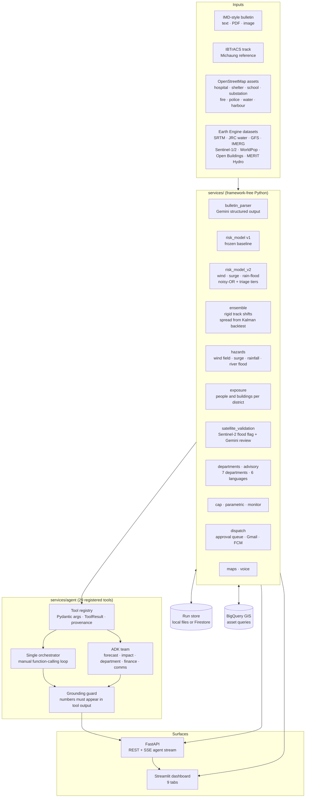

# SurgeSight architecture

This describes what is **built and running today**. The cloud deployment is described at the end as the planned target and is not built.

## 1. Layers

## 2. Design decisions

1. **Services first.** All logic lives in `services/`. Streamlit and FastAPI are thin. The React UI in the plan can replace Streamlit without touching the models.
2. **Gemini never calculates.** Every number Gemini states must appear in a tool result. `grounding_guard` compares each number in the answer with the numbers in that run's tool outputs (matching the precision shown), allows one rewrite, then redacts what is still unsupported and says so. Tools return compact top-15 views; full results stay in the run store.
3. **Deterministic tools, agentic orchestration.** Gemini chooses which tool to call and reads the results. The single orchestrator (a manual loop with a step budget) and the ADK team share the same registry, filtered by agent scope.
4. **Frozen v1 baseline.** The original screening model and its 3,977-asset table are unchanged, guarded by a baseline-match test. v2 and the department layers sit beside it.
5. **Leakage control.** Forecast rainfall comes only from the GFS run issued at or before the cutoff. Observed IMERG rainfall needs `hindcast=True` and is labelled validation-only. The experimental track uses only fixes at or before its cutoff.
6. **Honest labelling.** Outputs are "screening indices", not probabilities. Experimental tracks say they are not official. CAP alerts are always `Exercise`. Parametric figures are marked illustrative. Route results say "lower modelled exposure", never "safe".
7. **Human in the loop.** `queue_dispatch` is the only agent tool with a side effect, and it only queues. A person approves; `send` then honours `DISPATCH_MODE` (dry run by default) and an allow-list of recipients.
8. **Cached heavy data.** Earth Engine runs only in build scripts (`scripts/build_*.py`); runtime reads cached tables. The app therefore starts fast and works when Earth Engine is slow.

## 3. Risk model v2

| Hazard | Input | Score |
|---|---|---|
| Wind | Holland-profile wind field from the track | speed ÷ 120 km/h, capped at 1 |
| Surge | Landfall geometry, pressure drop, wind set-up, shelf depth, elevation, distance inland | screening index 0 to 1 (not metres) |
| Rain flood | GFS forecast rain, scaled by terrain flood score | rain ÷ 300 mm, times (0.5 + 0.5 × terrain score) |

The three terms are weighted (wind 0.8, surge 0.9, rain flood 0.8) and combined as `1 − ∏(1 − weight × term)`. The result is an absolute class (LOW, MODERATE, HIGH, CRITICAL) and a **relative triage tier** by percentile (top 10%, 30%, 60%, rest). On Michaung nearly every asset is HIGH or CRITICAL, so the tier is what separates priorities.

Against Sentinel-2 flooding, rainfall ranks flooded assets best (AUC 0.63) and wind ranks them below chance (0.39). Weights have not been recalibrated for flood impact.

## 4. Ensemble and uncertainty

The ensemble shifts the whole track by a random north-south and east-west distance and scales intensity. The spread per axis is the Kalman 12-hour backtest RMSE divided by √2 (about 36 km). Runs are seeded, so the same seed gives the same result. The 90% ellipse of the experimental forecast was too wide in the backtest (100% coverage), and a calibration factor is reported. This is calibrated in-sample on one storm.

## 5. Agent and tools

| Scope | Tools |
|---|---|
| forecast | parse_bulletin, bulletin_to_track, experimental_forecast, run_ensemble, nwp_comparison, river_flood, search_latest_bulletins, check_for_new_bulletin, geocode_place, district_weather |
| impact | score_track, run_scenario, explain_scenario, risk_v2, surge_hazard, rainfall_hazard, exposure_summary, satellite_validation, department_priority, assets_within, assets_in_district, get_asset_details, route_access, nearby_places, enrich_asset, and shared forecast tools |
| department | draft_advisory, department_priority, asset queries, Places and route tools |
| finance | parametric_triggers (with a grounded liquidity brief) |
| comms | synthesize_speech, queue_dispatch, search_latest_bulletins, check_for_new_bulletin, geocode_place |

On the free Gemini tier each model has a small daily quota, so the client falls back to the next model on a 429. The production path uses Vertex AI.

## 6. Alerting path

`advisory` (per department, per language) → `cap.build_cap_alert` (CAP 1.2, validated against the OASIS schema, polygon from the department's exposure footprint) → `dispatch.queue_dispatch` (status `pending_approval`) → a person approves → `send` (dry run, or live to the allow-list by Gmail and by web push through FCM). The monitor (`services/monitor.py`) automates the first half: poll for a new bulletin, dedupe by content hash, score, draft every department's advisory and CAP, and queue them. SACHET, India's CAP-based alert platform, is the real-world integration target.

## 7. Planned deployment (not built)

Cloud Run for the API and dashboard, Pub/Sub and Cloud Scheduler to trigger `/tasks/poll` and `/tasks/process` (the endpoints already verify Google OIDC tokens in cloud mode), Secret Manager for keys and tokens, Firebase Hosting for a React front end, Looker Studio over BigQuery views, and optionally Agent Engine for the ADK team.
