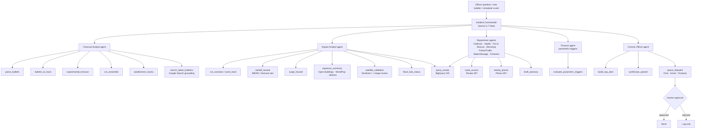
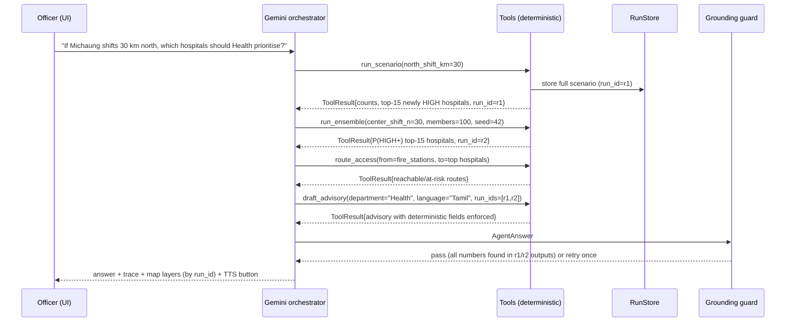
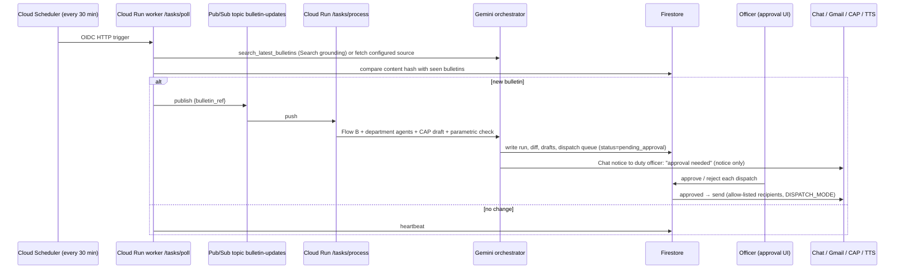

# SurgeSight — Implementation Plan

> **Audience:** any AI coding agent (or human) picking up this project.
> **Status date:** 2026-09-29.
> **Owner:** Charan Velavan (solo developer, working overnight).
> **Read this whole document before changing code.** Sections 2–4 are binding rules. Section 8 is the work queue.

---

## 0. How to use this document

1. Read **§1 Problem**, **§2 Decisions**, **§4 Invariants** first. They are non-negotiable.
2. Read **§3 Current state** so you do not rebuild what exists.
3. Pick the next unchecked work package in **§8**, in the order given in **§9**.
4. Each work package lists: goal, files, interfaces, tasks, acceptance criteria, validation marker, fallback.
5. A work package is **done** only when its validation marker prints and the Streamlit harness shows the feature.
6. After each work package: run all existing tests (§10), commit (Conventional Commits, see §12), tick the checkbox here.
7. If a Google service needs access you do not have, implement the **fallback** and mark the service `BLOCKED: <reason>` in §5.3. Never fake the output.

Status legend: `[ ]` todo · `[~]` in progress · `[x]` done · `BLOCKED` waiting on access.

---

## 1. Problem statement

### 1.1 Hackathon

- **Event:** Build with AI: Code for Communities 2.0 — Google Cloud × hack2skill
- **Track:** Problem Statement 05 — *Track-Based Cyclone Impact & Infrastructure Vulnerability Forecaster*
- **Theme:** Resilience
- **Prototype deadline:** 30 September 2026 (confirm exact submission time)
- **Explicit goal of the team:** use as many Google services as possible, each with a real job, with **Gemini as the brain**.

### 1.2 Official problem text

> **The Problem.** Extreme weather events in the Bay of Bengal and coastal APAC require rapid anticipatory action. Shifting disaster response from post-landfall recovery to pre-landfall evacuation planning, infrastructure hardening, and parametric insurance liquidity saves lives and livelihoods.
>
> **The Challenge.** Build an AI-powered predictive risk and vulnerability modeling platform utilizing Google Earth Engine (GEE) satellite feeds, real-time meteorological data, and Gemini 3.7 Flash's multimodal reasoning. The solution should simulate cyclone storm surges, predict local rainfall damage pathways, map exposure for critical infrastructure (power grids, arterial roads, medical shelters), and automate early-warning advisory dispatches for local municipal and disaster management authorities.

### 1.3 Requirement checklist (every item must map to a work package)

| # | Requirement from the brief | Work package |
|---|---|---|
| R1 | Google Earth Engine satellite feeds | WP2.2 IMERG, WP2.5 Open Buildings, WP3 Sentinel-1, existing SRTM/JRC/WorldPop |
| R2 | Real-time meteorological data | WP1.4 Search grounding, WP2.6 WeatherNext, WP2.2 forecast rain, WP8.4 Maps Weather API, WP5.6 monitor loop |
| R3 | Gemini 3.7 Flash multimodal reasoning | WP1 orchestrator, WP3 satellite image review, existing bulletin PDF/image parsing |
| R4 | Simulate storm surge | WP2.3 surge screening |
| R5 | Rainfall damage pathways | WP2.2 rainfall + terrain flood pathway |
| R6 | Critical infrastructure exposure (power, roads, medical, shelters) | existing assets + WP4 departments + WP8.2 Routes access |
| R7 | Automated early-warning dispatch | WP5 CAP, Chat, Gmail, Firestore, Scheduler + Pub/Sub |
| R8 | Parametric insurance liquidity | WP5.2 parametric trigger engine |
| R9 | Pre-landfall evacuation / hardening | WP4 department actions, WP2.1 ensemble ranking |
| R10 | India-scale reach, multilingual | WP7 second cyclone (Fani/Odisha), WP4.4 languages |

### 1.4 Evaluation weights

| Criterion | Weight |
|---|---:|
| AI / Technical Execution | 25% |
| Problem-Solution Fit | 20% |
| Depth & Reach Across India | 20% |
| Deployability & Scalability | 20% |
| Impact Potential | 15% |

### 1.5 One-line product

SurgeSight converts an official cyclone forecast into infrastructure-level consequences, lets authorities test how those consequences change if the forecast shifts, and — with Gemini orchestrating deterministic tools — produces and dispatches grounded, department-specific, multilingual actions before landfall.

---

## 2. Decisions (fixed — do not re-litigate)

| ID | Decision |
|---|---|
| D1 | **Gemini is the brain = the orchestrator.** Gemini decides which tools to run, in what order, reads the results, looks at imagery, writes advisories and triggers dispatch. **Gemini never calculates a risk number.** (§4.1) |
| D2 | **Maximise Google services, each with a real job.** No logo-only integrations. (§5.3) |
| D3 | **Nothing is cut.** All items in this plan get built. Order (§9) decides what lands first. |
| D4 | **Authority product ("SurgeSight Command") first.** Departments: District Collector / DDMA, Health, Fire & Rescue, Electricity, Police / Traffic, Water / Sewage, Fisheries. |
| D5 | **Public citizen app is deferred** until Command is complete (WP13). |
| D6 | **Streamlit is the development harness now.** It is used to test every service while the backend is built. |
| D7 | **Final UI is React + TypeScript** (Vite, Tailwind, shadcn/ui, `@vis.gl/react-google-maps`, deck.gl, TanStack Query), built after all services are connected (WP10). Streamlit is then retired. |
| D8 | **Deployment happens at the last stage** (WP11). An optional 30-minute smoke deploy early is recommended to surface credential/container issues (WP0.6), but not required. |
| D9 | **Services-first architecture.** All logic lives in `services/`. UI layers (Streamlit now, FastAPI + React later) only call services. |
| D10 | **Case study:** Cyclone Michaung 2023 (Tamil Nadu / Andhra Pradesh). **Second geography:** Cyclone Fani 2019 (Odisha). |

---

## 3. Current state (verified against code on 2026-09-29)

### 3.1 Environment

- Python **3.14.7**, virtualenv at `.venv/`
- Key packages: `google-genai 2.25.0`, `earthengine-api 1.7.46`, `google-cloud-texttospeech 2.37.0`, `streamlit 1.64.0`, `pandas 3.0.6`, `numpy 2.5.3`, `geopandas 1.2.0`, `shapely 2.1.2`, `pyproj 3.8.0`, `pydeck 0.9.3`, `pydantic 2.13.5`
- `.env` keys (names only): `GEMINI_API_KEY`, `GOOGLE_CLOUD_PROJECT`
- **Not a git repository yet.** No `requirements.txt`.
- A Streamlit skill exists at `.claude/skills/developing-with-streamlit` — use it when editing `app.py`.

### 3.2 Working modules (`services/`)

| File | Key public API | Notes |
|---|---|---|
| `gemini_client.py` | `create_client()`, `generate_structured(*, contents, schema, system_instruction, temperature=0.0, max_output_tokens=4096)`; `MODEL_NAME = "gemini-3.7-flash"` | Gemini Developer API via API key. Retries. Automatic function calling disabled. |
| `bulletin_parser.py` | `parse_bulletin_text(text) -> CycloneBulletin`, `parse_bulletin_file(data, mime_type, filename)`; models `CycloneBulletin`, `ForecastPoint(timestamp, lat, lon, wind_kmph, pressure_hpa)` | Multimodal: text, PDF, PNG, JPEG, WebP, HEIC. |
| `risk_model.py` | `haversine_km`, `classify_risk`, `attach_nearest_track(assets, track, *, wind_multiplier, filter_to_corridor)`, `score_assets_from_terrain(assets)`; constants `REFERENCE_WIND_KMH=120`, `SCREENING_CORRIDOR_KM=140`, `WEIGHTS` | **v1 risk model. Frozen** (§4.5). |
| `scenario_engine.py` | `run_scenario(north_shift_km, east_shift_km, intensity_change_pct, *, save_outputs)`, `shift_track_geodesically`, `compare_scenario(baseline, shifted_track)`, `score_custom_track(custom_track, baseline=None)`, `build_scenario_summary`, `dataframe_geojson` | 0.038 s per run on 3,977 assets. |
| `scenario_explainer.py` | `explain_scenario(...)` | Gemini explanation of scenario deltas. |
| `advisory.py` | `AUDIENCES` (Collector, Electricity, Health), `LANGUAGES` (English, Tamil, Telugu), `build_advisory_context(audience)`, `generate_role_advisory(audience, language) -> RoleAdvisory` | Deterministic fields re-enforced after generation. |
| `tts.py` | `LANGUAGE_CODES`, `synthesize_advisory(advisory, language) -> bytes` | ADC first, then REST; `gcloud` subprocess fallback. |
| `track_forecaster.py` | `forecast_track`, `run_experimental_forecast(track, cutoff, *, wind_grid, intensity_mode, include_impacts)`, `forecast_geojson`, `ellipse_polygon`, `compare_track_impacts`; `DEFAULT_DEMO_CUTOFF = 2023-12-03 12:00` | Position-only Kalman + wind-informed model. Leakage-controlled. |
| `track_forecast_explainer.py` | `explain_forecast_difference(...)`, `ungrounded_numbers(explanation, context)` | Contains a number-grounding check — generalise it (WP1.3). |
| `wind_provider.py` | `load_wind_grid(...)`, `WindGrid`, `SteeringVector`, `FutureWindAccessError` | GFS via Open-Meteo, cached at `data/raw/wind/`. |

**Empty stub files** (0 lines): `services/earth_engine.py`, `services/exposure_engine.py`, `services/gemini.py`, `services/hazard_engine.py`. Repurpose `earth_engine.py` (WP0.4); delete the other three or fill them per §6.

### 3.3 Scripts (`scripts/`)

Pipeline: `extract_michaung.py` → `build_michaung_terrain.py` → `fetch_osm_infrastructure.py` → `score_infrastructure_risk.py` → `analyze_risk_distribution.py`.
Forecast: `generate_experimental_track.py`, `backtest_track_forecast.py`.
Tests (print markers): `test_bulletin_parser.py`, `test_scenario_engine.py`, `test_track_forecaster.py`.

### 3.4 Data

- Track: `data/processed/michaung_track.csv` — columns `SID, NAME, ISO_TIME, LAT, LON, WIND_KT, PRESSURE_HPA, BASIN, WIND_KMH`
- Assets: `data/processed/scored_assets.csv` — columns `asset_type, name, osm_element, osm_id, lat, lon, distance_to_track_km, operator, ref, source_tile, amenity, power, highway, emergency, healthcare, voltage, website, phone, nearest_track_wind_kmh, elevation_m, water_occurrence_pct, wind_score, terrain_flood_score, combined_risk_score, risk_class`
- OSM layers: `data/processed/osm/{hospitals,schools,shelters,substations,arterial_roads,critical_assets}.{csv,geojson}`, `michaung_impact_corridor.geojson`
- Summaries: `risk_summary.json`, `risk_diagnostics.json`, `scenario_summary.json`, `track_backtest.{csv,json}`, `experimental_track_*.{geojson,json}`, `michaung_terrain_summary.json`
- Raw (git-ignored): `data/raw/{ibtracs.csv, sample_michaung_bulletin.txt, wind/, osm_cache/, ee_asset_samples.json}`
- Total `data/` ≈ 390 MB

### 3.5 Streamlit harness (`app.py`, 46 KB)

Tabs: **Bulletin Intelligence**, **Role-specific advisories**, **Forecast Simulator**, **Experimental Track Forecast**. Some logic lives inside `app.py` (loaders, formatting, segment styling) — move reusable logic into `services/` as you touch it.

### 3.6 Known issues (must be fixed — see WP0 / WP1)

| ID | Issue | Evidence | Fix in |
|---|---|---|---|
| K1 | Parsed bulletin does **not** feed the risk engine | `app.py:290` "does not replace the historical…" | WP1.2 |
| K2 | Risk classes barely discriminate: LOW 4, MODERATE 2,228, HIGH 1,737, CRITICAL 8; 950 hospitals HIGH+ | `risk_summary.json`; proximity clipped to [0.5, 1.0] in `risk_model.py` | WP2.1 ensemble ranking, WP2.4 v2 wind field |
| K3 | Terrain summary likely includes ocean pixels (43.1% ≤ 5 m, 45.9% ≤ 10 m, mean 78.6 m) | `michaung_terrain_summary.json` | WP0.4 |
| K4 | TTS truncates by characters, not bytes: `text[:3500]` after a 4,800-byte check. Tamil/Telugu ≈ 3 bytes/char → ~10 KB, over the 5,000-byte API limit | `services/tts.py` `synthesize_advisory` | WP0.3 |
| K5 | OSM "hospital" set includes non-hospitals (e.g. "4 Squares Dentistry") | first row of `scored_assets.csv` | WP0.5 |
| K6 | `.gitignore` excludes `data/raw/`, but tests need `data/raw/sample_michaung_bulletin.txt` | `.gitignore`, `scripts/test_bulletin_parser.py` | WP0.1 |
| K7 | `tts.py` falls back to the `gcloud` CLI, which does not exist on Cloud Run | `services/tts.py::_access_token` | WP0.3 |
| K8 | No surge model, no rainfall model, no parametric, no dispatch, no CAP | code search | WP2, WP5 |
| K9 | Experimental 90% ellipse is over-conservative (100% of verifying points inside) | README §17 | WP2.1 (calibration note) |

---

## 4. Invariants (binding rules for every agent)

### 4.1 Gemini decides, it does not calculate

Gemini is the orchestrator that runs the whole workflow: it reads the bulletin, decides which tools to run, calls the risk and ensemble engines, looks at satellite imagery, drafts the advisories and triggers the dispatch. **The deterministic models are tools that Gemini calls.**

```
                    GEMINI 3.7 FLASH — ORCHESTRATOR (ADK / function calling)
                                        │
 ┌──────────┬──────────┬──────────┬─────┴─────┬──────────┬──────────┬──────────┐
 parse_     run_       run_       get_rain /  query_     find_      draft_     dispatch
 bulletin   scenario   ensemble   get_surge   assets     places /   advisory   (CAP, Chat,
 (multi-    (your      (100       (Earth      (BigQuery  routes     + CAP      Gmail, FCM,
 modal)     engine)    tracks)    Engine)     GIS)       (Maps)                TTS)
```

This lets the pitch say that Gemini runs every step, while still saying truthfully that **Gemini never makes up a risk number**. Judges score both "AI depth" and "trustworthiness"; this design gets both. If Gemini produced the risk scores itself, one judge question ("how do you know it didn't hallucinate that hospital?") would undo it.

Concretely:

- Gemini **may**: choose tools, choose arguments, sequence steps, compare tool outputs, reason over images, summarise, translate, draft advisories/CAP text, request dispatch.
- Gemini **may not**: produce coordinates, distances, wind speeds, scores, classes, counts, probabilities, payouts, or asset identities that did not come from a tool result.
- Every number in a Gemini answer must appear in a tool output of the same run. Enforced by the grounding guard (WP1.3).
- Deterministic fields (severity, asset lists, scores) are **overwritten from tool data after generation**, as `advisory.py` already does.

### 4.2 Every Google service has a real job

Judges can tell when a service is only there to be counted. Each service in §5.3 must be on the execution path of a real user flow (§7). If a service cannot be accessed, implement the fallback and label it — do not ship a stub that pretends.

### 4.3 Services-first

- All logic in `services/`. **No `st.*` calls inside `services/`.**
- Service functions take plain arguments and return **JSON-serialisable** data (dicts, lists, Pydantic models). DataFrames may be used internally or returned alongside a serialisable summary.
- Each public service function must be usable as (a) a Gemini tool, (b) a FastAPI endpoint (WP9), (c) a Streamlit call — without modification.

### 4.4 Tool results are compact

Tools must **not** return thousands of assets to Gemini. Return counts, top-N (default 15), and a `run_id`. Full results are stored in the run store (§6.4) and fetched by the UI by `run_id`.

### 4.5 v1 risk model is frozen

`services/risk_model.py` and the baseline outputs must keep passing `SURGESIGHT_SCENARIO_BASELINE_MATCH_OK`. New hazards go into `risk_model_v2.py`. The UI shows v1 and v2 side by side until v2 is validated.

### 4.6 No data leakage

Historical replays may only use data valid at or before the cutoff. **Observed IMERG rainfall after the cutoff may be used for validation/hindcast only, never as pre-landfall input.** Forecast-mode rainfall must come from a forecast product (GFS via Open-Meteo, or WeatherNext).

### 4.7 Honest labelling

- Risk scores are **screening indices**, not damage probabilities.
- Surge is a **screening surge index**, not a hydrodynamic model (not SLOSH/ADCIRC).
- Experimental tracks: "SurgeSight Experimental Track Forecast — not an official meteorological forecast. IMD remains authoritative."
- CAP output uses `<status>Exercise</status>` in the prototype.
- Parametric outputs are **illustrative**, not insurance products.

### 4.8 Human in the loop for dispatch

The agent may **draft** and **queue** dispatches. Sending to any channel requires an explicit human approval in the UI. Default `DISPATCH_MODE=dry_run`. In `live` mode, recipients must be on an allow-list (the developer's own test Chat space / email) during the hackathon.

### 4.9 Reproducibility

Random processes (ensemble) take a `seed` (default 42) and record it in outputs. Every run records `model_version`, `data_version`, `computed_at_utc`.

### 4.10 Secrets

Never commit or print keys, tokens, or service-account JSON. Locally use `.env`; in cloud use Secret Manager. Do not put the GCP project ID or service-account email in public docs.

---

## 5. Target architecture

### 5.1 Layered view

```
┌──────────────────────────────────────────────────────────────────────────────┐
│ PRESENTATION   Streamlit harness (now)  →  React + TS + Google Maps (WP10)    │
│                Firebase Hosting · Firebase Auth (department logins)          │
├──────────────────────────────────────────────────────────────────────────────┤
│ API            FastAPI on Cloud Run (WP9) · SSE stream for agent traces       │
├──────────────────────────────────────────────────────────────────────────────┤
│ BRAIN          Gemini 3.7 Flash orchestrator (function calling → ADK)        │
│                Incident Commander + sub-agents · grounding guard · trace     │
├──────────────────────────────────────────────────────────────────────────────┤
│ TOOLS          deterministic services: bulletin→track, scenario, ensemble,   │
│ (services/)    wind field, rainfall, surge, exposure, satellite validation,  │
│                departments, advisory, CAP, parametric, dispatch, maps, TTS   │
├──────────────────────────────────────────────────────────────────────────────┤
│ DATA           Earth Engine · WeatherNext · Flood Hub · Open-Meteo/GFS ·      │
│                IBTrACS · OSM · Maps Platform · BigQuery GIS · Firestore ·    │
│                Cloud Storage · local cache (offline fallback)                │
├──────────────────────────────────────────────────────────────────────────────┤
│ AUTOMATION     Cloud Scheduler → Pub/Sub → Cloud Run worker → agent →        │
│                "what changed" → approval queue → Chat / Gmail / CAP / TTS    │
├──────────────────────────────────────────────────────────────────────────────┤
│ OPS            Cloud Run · Cloud Build · Artifact Registry · Secret Manager · │
│                Looker Studio on BigQuery                                     │
└──────────────────────────────────────────────────────────────────────────────┘
```

### 5.2 Agent architecture



Implementation path: **WP1** builds a single orchestrator with a tool registry (manual function-calling loop). **WP1.5** ports it to ADK with the sub-agents above, reusing the same tool functions. Tools are framework-agnostic.

### 5.3 Google services map

Every service has a job, a work package, and a fallback. ⭐ = new beyond the original README.

| Google service | Job in SurgeSight | WP | Fallback if unavailable | Status |
|---|---|---|---|---|
| **Gemini 3.7 Flash** | Orchestrator agent, bulletin parsing, satellite-image reasoning, advisories, translation, explanations | WP1, WP3, WP4 | none (core) | partly built |
| ⭐ **Agent Development Kit / Vertex AI Agent Engine** | Multi-agent setup: Incident Commander + Forecast, Impact, department, Finance, Comms agents | WP1.5, WP11 | single orchestrator from WP1 | todo |
| ⭐ **Gemini with Google Search grounding** | Pulls the latest bulletins and news for live mode, with cited sources | WP1.4 | manual bulletin upload | todo |
| ⭐ **Gemini Live API** | Voice Q&A for control rooms ("which hospitals changed since the last bulletin?") | WP6.2 | Speech-to-Text → agent → TTS | todo |
| **Earth Engine** | Elevation, surface water, population, **GPM IMERG rainfall**, **Sentinel-1 flood extent**, ⭐ **Google Open Buildings** (exposed buildings, not just population), district boundaries, bathymetry | WP0.4, WP2, WP3 | cached rasters/samples in `data/processed` | partly built |
| ⭐ **WeatherNext (Google DeepMind)** | Google's AI weather / cyclone ensemble forecasts via Earth Engine or BigQuery, shown beside the Kalman model | WP2.6 | Kalman + SurgeSight ensemble; label "WeatherNext access pending" | **apply for access now** |
| ⭐ **Google Flood Hub / Flood Forecasting API** | Google's riverine flood forecasts for India (live mode) | WP2.7 | hide panel, label pending | **apply for access now** |
| ⭐ **Maps Platform Weather API** | Current and forecast conditions per district/locality (Command now, public app later) | WP8.4 | Open-Meteo | todo |
| **Maps JavaScript API** | Command map (React, WP10) | WP10 | pydeck in Streamlit | todo |
| **Places API** | Verify and enrich hospitals/shelters (phone, address, open status) | WP8.1 | OSM attributes | todo |
| **Routes API** | Fire/ambulance access: can a fire station reach a hospital while avoiding HIGH segments | WP8.2 | straight-line distance, labelled | todo |
| **Geocoding API** | Resolve bulletin place names ("near Bapatla") to coordinates for landfall | WP8.3 | Gemini-free gazetteer from OSM | todo |
| ⭐ **BigQuery (GIS)** | Store assets (GEOGRAPHY), scenario/ensemble runs; spatial queries exposed as parameterised tools | WP5.5 | local GeoPandas queries | todo |
| ⭐ **Firestore** | Live alert state, approval queue, advisory history, seen-bulletin hashes | WP5.4 | local JSON store | todo |
| ⭐ **Cloud Scheduler + Pub/Sub** | Poll for new bulletins → agent → "what changed" → queue dispatch. **This is the "automate dispatch" requirement.** | WP5.6, WP11 | manual "check now" button | todo |
| **Firebase (Hosting, Auth, FCM)** | Hosting for React UI, department logins; FCM for citizen alerts (WP13) | WP10, WP11, WP13 | Cloud Run static hosting | todo |
| **Cloud Text-to-Speech** | Voice alerts in each language | exists, WP0.3, WP4.4 | text only | built |
| ⭐ **Cloud Speech-to-Text** | Voice questions in (push-to-talk) | WP6.1 | text input | todo |
| ⭐ **Google Chat webhooks** | Send department advisories to control-room spaces | WP5.3 | dry-run log | todo |
| ⭐ **Gmail API** | Email advisory + CAP attachment to department inboxes | WP5.3 | dry-run log | todo |
| **Cloud Run** | API, worker, (temporary) Streamlit | WP11 | local | todo |
| **Cloud Build + Artifact Registry** | Container build and storage | WP11 | local docker build | todo |
| ⭐ **Secret Manager** | API keys, webhook URLs, OAuth tokens | WP11 | `.env` locally | todo |
| **Cloud Storage** | Large cached data, generated audio, satellite thumbnails, CAP files | WP11 | local disk | todo |
| ⭐ **Looker Studio** | Summary dashboard for state officials on BigQuery views | WP11.6 | screenshot in deck | todo |

**Gemini's multimodal side becomes real here:** render the Sentinel-1 flood image and the IMERG rainfall map from Earth Engine as images, then give them to Gemini: *"Here is the observed flood extent and our pre-landfall screening; where did we miss?"* (WP3). The metrics are computed deterministically; Gemini reasons over the images and the metrics together.

### 5.4 Target repository layout

```text
SurgeSight/
├── app.py                          # Streamlit dev harness (retired after WP10)
├── requirements.txt                # WP0.2
├── config/
│   ├── regions/
│   │   ├── michaung_2023.toml      # WP0.7
│   │   └── fani_2019.toml          # WP7
│   ├── departments.toml            # WP4.1
│   └── parametric_triggers.toml    # WP5.2
├── services/
│   ├── config.py                   # settings, env, region loader (WP0.7)
│   ├── gemini_client.py            # + Vertex mode switch (WP1.1)
│   ├── agent/
│   │   ├── orchestrator.py         # function-calling loop + trace (WP1.1)
│   │   ├── tools.py                # tool registry, ToolResult (WP1.1)
│   │   ├── prompts.py              # system instructions (WP1.1)
│   │   ├── grounding_guard.py      # number provenance check (WP1.3)
│   │   └── adk_app.py              # ADK multi-agent (WP1.5)
│   ├── bulletin_parser.py          # exists
│   ├── bulletin_track.py           # CycloneBulletin → track DataFrame (WP1.2)
│   ├── risk_model.py               # v1 — FROZEN
│   ├── risk_model_v2.py            # wind field + surge + rain combine (WP2.4)
│   ├── hazards/
│   │   ├── wind_field.py           # Holland profile (WP2.4)
│   │   ├── rainfall.py             # IMERG + forecast rain (WP2.2)
│   │   └── surge.py                # screening surge (WP2.3)
│   ├── ensemble.py                 # WP2.1
│   ├── exposure.py                 # Open Buildings, WorldPop footprint, districts (WP2.5)
│   ├── earth_engine.py             # EE init, sampling, thumbnails (WP0.4)
│   ├── satellite_validation.py     # Sentinel-1 + Gemini image review (WP3)
│   ├── weathernext.py              # WP2.6
│   ├── flood_hub.py                # WP2.7
│   ├── departments.py              # WP4.1
│   ├── advisory.py                 # extend to departments/languages (WP4.3)
│   ├── cap.py                      # CAP 1.2 XML (WP5.1)
│   ├── parametric.py               # WP5.2
│   ├── dispatch/
│   │   ├── router.py               # approval gate, allow-list, dry-run (WP5.3)
│   │   ├── chat.py
│   │   └── gmail.py
│   ├── store/
│   │   ├── base.py                 # RunStore interface (WP1.1)
│   │   ├── local_store.py
│   │   ├── firestore_store.py      # WP5.4
│   │   └── bigquery_store.py       # WP5.5
│   ├── monitor.py                  # bulletin polling + diff (WP5.6)
│   ├── maps/
│   │   ├── places.py  routes.py  geocoding.py  weather.py   # WP8
│   ├── voice/
│   │   ├── stt.py                  # WP6.1
│   │   └── live.py                 # WP6.2
│   ├── tts.py                      # fix (WP0.3)
│   ├── scenario_engine.py  scenario_explainer.py
│   ├── track_forecaster.py  track_forecast_explainer.py  wind_provider.py
├── api/                            # FastAPI (WP9)
│   ├── main.py
│   └── routers/*.py
├── frontend/                       # React + TS (WP10)
├── infra/                          # Dockerfile, cloudbuild.yaml, deploy.sh (WP11)
├── scripts/                        # pipelines + tests (see §10)
├── data/
└── docs/
    └── IMPLEMENTATION_PLAN.md      # this file
```

---

## 6. Core contracts

### 6.1 `ToolResult` (every tool returns this)

```python
class Provenance(BaseModel):
    source: str                 # e.g. "risk_model_v1", "earth_engine:NASA/GPM_L3/IMERG_V07"
    model_version: str          # e.g. "v1", "v2.0"
    data_version: str           # e.g. "michaung_2023@2026-09-29"
    computed_at_utc: str

class ToolResult(BaseModel):
    ok: bool
    tool: str
    run_id: str | None = None   # full data retrievable from RunStore
    data: dict[str, Any]        # COMPACT: counts, top-N, key numbers
    warnings: list[str] = []
    provenance: Provenance
    error: str | None = None
```

### 6.2 Tool registration

```python
# services/agent/tools.py
TOOLS: dict[str, ToolSpec] = {}

def tool(name: str, *, agent_scopes: set[str], side_effect: bool = False):
    """Decorator. Registers a typed function (Pydantic args model + docstring)
    as a Gemini function declaration. side_effect=True tools (dispatch) always
    route through the approval gate."""
```

- Arguments are validated with a Pydantic model before execution.
- Docstrings are the tool descriptions Gemini sees — write them for Gemini: when to use, units, limits.
- `agent_scopes` controls which ADK sub-agent can see the tool (WP1.5).

### 6.3 Agent answer

```python
class AgentAnswer(BaseModel):
    answer_markdown: str
    run_ids: list[str]
    numbers_cited: list[str]          # every number in the answer, as strings
    recommended_actions: list[str]
    uncertainty_notes: list[str]
    requires_approval: list[str] = [] # queued dispatch ids
```

### 6.4 Run store

`RunStore` interface: `put(run_id, kind, payload) -> None`, `get(run_id) -> dict`, `list(kind, limit) -> list`. Implementations: `LocalStore` (JSON under `data/runs/`, git-ignored), `FirestoreStore` (WP5.4). Selected by `SURGESIGHT_STORE=local|firestore`.

### 6.5 Trace

Each orchestrator run produces `trace: list[TraceStep(step, agent, tool, args, ok, duration_ms, summary)]`. The Streamlit Agent Console (and later the React side panel via SSE) renders the trace live. **This is a key demo moment** — judges watch Gemini choose tools.

---

## 7. Execution flows

### 7.1 Flow A — Officer asks a question (interactive)



Step rules:
1. Orchestrator runs at most **12 tool steps** per question.
2. Tool errors are returned to Gemini as `ToolResult(ok=false, error=...)`; Gemini may retry with corrected args once.
3. Grounding guard fails → one corrective retry → if still failing, return the answer with ungrounded numbers **removed and flagged**.

### 7.2 Flow B — New bulletin (manual upload or grounded search)

```
bulletin text/PDF/image  ──►  parse_bulletin (Gemini multimodal, schema-constrained)
                                   │
                                   ▼
                         bulletin_to_track (deterministic)
                         - current position + forecast points → LAT/LON/WIND_KMH/ISO_TIME
                         - missing wind → carry last known wind, flagged
                         - landfall text → Geocoding API (WP8.3) → optional landfall point
                                   │
                                   ▼
                         score_track (scenario_engine.score_custom_track, v1)
                         + risk_model_v2 hazards (WP2.4)
                                   │
                                   ▼
                         diff vs previous bulletin run (monitor.diff_runs)
                                   │
                                   ▼
                         Gemini: "what changed" summary + department routing
```

### 7.3 Flow C — Automated monitoring and dispatch (deployed)



### 7.4 Flow D — Multimodal satellite validation (Michaung hindcast)

```
Earth Engine:
  Sentinel-1 GRD (VV, IW) pre-event median (Nov 2023) vs post-event (4–6 Dec 2023)
  → change detection → observed flood mask (minus permanent water, steep slopes)
  IMERG V07 accumulation 1–6 Dec 2023
        │
        ├─► deterministic metrics (satellite_validation.compute_metrics):
        │     share of HIGH+ assets inside observed flood, hit rate, false-alarm rate,
        │     per asset type, per district
        │
        └─► thumbnails (getThumbURL → PNG): flood mask, rainfall, screening overlay
                  │
                  ▼
        Gemini multimodal: images + metrics JSON →
        "Here is the observed flood extent and our pre-landfall screening; where did we miss?"
        → structured SatelliteReview {missed_areas_text, over_flagged_areas_text,
           likely_causes, model_improvements} — numbers only from metrics JSON
```

### 7.5 Flow E — Department dispatch

```
run_id ─► departments.filter_assets(department) ─► draft_advisory(department, language)
       ─► build_cap_alert(run_id, department) ─► synthesize_speech(language)
       ─► queue_dispatch(channel ∈ {chat, gmail}, recipients from config, attachments=[CAP, MP3])
       ─► approval ─► send ─► dispatch_log (Firestore + BigQuery)
```

---

## 8. Work packages

Each WP: **Goal · Files · Tasks · Acceptance · Marker · Fallback · Estimate · Depends on**.

---

### WP0 — Setup, hygiene and known-issue fixes

**Goal:** a safe, reproducible base. **Estimate:** 1.5 h. **Depends on:** nothing.

- [x] **WP0.1 Git.** `git init`; set local identity (see §12). Fix `.gitignore`: keep ignoring `data/raw/` bulk but **un-ignore** `data/raw/sample_michaung_bulletin.txt`; add `data/runs/`, `*.mp3` outputs, `frontend/node_modules/`, `frontend/dist/`, `token*.json`, `*credentials*.json`. First commit: `chore: initial snapshot of working Streamlit prototype`. Tag `v0-streamlit-baseline`.
- [x] **WP0.2 `requirements.txt`.** Pin versions from §3.1 plus new: `fastapi`, `uvicorn`, `sse-starlette`, `google-cloud-firestore`, `google-cloud-bigquery`, `google-cloud-pubsub`, `google-cloud-secret-manager`, `google-cloud-speech`, `google-cloud-storage`, `google-adk`, `googlemaps` (or plain `requests` to Maps REST), `google-api-python-client` + `google-auth-oauthlib` (Gmail), `lxml` (CAP). Verify each installs on Python 3.14; if a wheel is missing, note it and use REST. **Done 2026-09-29:** all install except `google-adk` (omitted: current release pins `google-genai<2`, which would downgrade the core client — resolve in WP1.5, e.g. separate venv or newer ADK); `googlemaps` not used (plain REST via `requests`).
- [x] **WP0.3 TTS fixes (K4, K7).** Truncate by **UTF-8 bytes** at a sentence boundary under 4,800 bytes (`_truncate_utf8(text, max_bytes)`), never split a multibyte character. Remove the `gcloud` subprocess fallback on Cloud Run (keep it only when `SURGESIGHT_ENV=local`). Add `scripts/test_tts.py` synthesising English, Tamil, Telugu → marker `SURGESIGHT_TTS_MULTILINGUAL_OK`.
- [x] **WP0.4 Earth Engine helper + ocean mask (K3).** Implement `services/earth_engine.py`: `init_ee(project)`, `sample_points(image, points, scale)`, `thumbnail_png(image, region, vis_params, dimensions) -> bytes`. Rerun terrain summary clipped to land using `USDOS/LSIB_SIMPLE/2017` (country = India). Update `michaung_terrain_summary.json` and README numbers. Asset-level values are unaffected (assets are on land). Marker `SURGESIGHT_TERRAIN_LANDMASK_OK`.
- [x] **WP0.5 Hospital data quality (K5).** Add `facility_quality` column: `hospital` if OSM `healthcare=hospital` or `amenity=hospital` **and** name does not match `dental|dentistry|clinic|pharmacy|diagnostic|scan|lab|optical|eye care`; else `clinic_or_other`. **Do not change v1 outputs.** v2 and department views use `facility_quality == "hospital"`. Report both counts.
- [ ] **WP0.6 (optional, recommended) smoke deploy.** *(skipped for now)* Minimal container of current Streamlit to Cloud Run to surface ADC / Earth Engine / memory / websocket issues early. Delete afterwards if unwanted.
- [x] **WP0.7 Config.** `services/config.py` with `Settings` (env-driven) and `load_region(name)` reading `config/regions/<name>.toml` (Python `tomllib`). Move hard-coded Michaung paths (`TRACK_FILE`, `BASELINE_ASSETS_FILE`, `ASSETS_FILE`, `DEFAULT_CACHE`) behind the region config **without changing defaults**.
- [ ] **WP0.8 Access requests (human, browser).** Request WeatherNext data access and Flood Forecasting API access. Enable in GCP: Maps JavaScript, Places (New), Routes, Geocoding, Weather, Speech-to-Text, Firestore, BigQuery, Pub/Sub, Cloud Scheduler, Secret Manager, Vertex AI, Gmail API. Create a Maps API key restricted by API + referrer. **Status 2026-09-29:** `scripts/check_google_services.py` passes 18/18 (Gemini, EE, Weather, Geocoding, Places, Routes, TTS, STT, Firestore, BigQuery, Vertex, Secret Manager, Scheduler, Pub/Sub, Storage, Maps JS key). **Still human:** WeatherNext access, Flood Forecasting API access, Gmail API + OAuth client.

**Acceptance:** all existing markers still print; new markers above print; first commit exists.

---

### WP1 — The Gemini brain

**Goal:** Gemini orchestrates every existing capability through tools, with a visible trace. **Estimate:** 3 h + 1 h (ADK). **Depends on:** WP0.

- [x] **WP1.1 Orchestrator core.** *(done 2026-09-29: `submit_answer` pseudo-tool ends the loop; UI in `ui/agent_console.py`; `scripts/run_all_tests.py` added)*
  - `services/gemini_client.py`: add `create_client()` switch — `GOOGLE_GENAI_USE_VERTEXAI=true` → `genai.Client(vertexai=True, project=..., location=...)`, else API key. Add `MODEL_NAME` from env `GEMINI_MODEL` (default `gemini-3.7-flash`).
  - `services/agent/tools.py`: registry + `ToolResult` (§6.1–6.2).
  - `services/agent/orchestrator.py`: **manual** function-calling loop (do not use SDK automatic function calling — we need per-step trace and validation). `run_agent(question, *, context_run_ids=None, language="English", on_step=None) -> (AgentAnswer, trace)`. `on_step` callback streams steps to UI.
  - `services/agent/prompts.py`: Incident Commander system instruction encoding §4.1, §4.7, §4.8.
  - `services/store/local_store.py`.
  - Register existing capabilities as tools:

  | Tool | Wraps | Returns (compact) |
  |---|---|---|
  | `parse_bulletin` | `bulletin_parser.parse_bulletin_text/file` | parsed fields |
  | `bulletin_to_track` | WP1.2 | track points, flags, run_id |
  | `score_track` | `scenario_engine.score_custom_track` | class counts, top-N, run_id |
  | `run_scenario` | `scenario_engine.run_scenario(save_outputs=False)` | summary, newly HIGH top-N, runtime |
  | `experimental_forecast` | `track_forecaster.run_experimental_forecast` | horizon points, errors, impact counts |
  | `explain_scenario` | `scenario_explainer.explain_scenario` | explanation |
  | `draft_advisory` | `advisory.generate_role_advisory` (extended in WP4) | advisory JSON |
  | `synthesize_speech` | `tts.synthesize_advisory` | audio URI/run_id |
  | `get_asset_details` | RunStore / assets CSV | one asset's full deterministic fields |

  - Streamlit: new **Agent Console** tab — question box, live trace (tool, args, duration, ✓/✗), final answer, links to map layers by `run_id`.
  - Test `scripts/test_agent.py`: 3 canned questions; asserts ≥ 1 tool call each, grounding passes, no tool errors → `SURGESIGHT_AGENT_OK`.
- [x] **WP1.2 Bulletin → risk (K1).** `services/bulletin_track.py`: `bulletin_to_track(bulletin: CycloneBulletin, *, previous_track: pd.DataFrame | None) -> TrackBuildResult{track_df, flags}`. Rules: current position is the first point; forecast points follow in time order; points with null lat/lon are dropped and flagged; null wind → carry forward last known wind, flag `wind_carried_forward`; fewer than 2 points → error "insufficient forecast points". Then `score_track`. Bulletin tab gets a **"Score this bulletin"** button. Test with `sample_michaung_bulletin.txt` → `SURGESIGHT_BULLETIN_TO_RISK_OK`.
- [x] **WP1.3 Grounding guard.** Generalise `track_forecast_explainer.ungrounded_numbers` into `services/agent/grounding_guard.py::check(answer, tool_results) -> list[str]`. Normalise numbers (commas, units, rounding to the precision shown). Allow-list: years, lead hours 6/12/24, language/UI constants, emergency number 112. Test with a deliberately injected fake number → caught → `SURGESIGHT_GROUNDING_GUARD_OK`.
- [x] **WP1.4 Google Search grounding.** Tool `search_latest_bulletins(cyclone_name: str | None, region: str) -> {items:[{title, uri, snippet, published}], answer_text}` implemented as a **separate** Gemini call with the built-in `google_search` tool (keep it separate from custom function declarations; verify SDK support for combining them before trying). Return grounding citations from response metadata. Feeds Flow B/C. Marker `SURGESIGHT_SEARCH_GROUNDING_OK`. **Done 2026-09-29:** `services/search_grounding.py` + tool `search_latest_bulletins`; separate Gemini call with built-in `google_search`; citations come from grounding metadata (uri is a Google redirect, title is the domain). Live test returns a summary with 8 sources and correctly says Michaung is not active. `SURGESIGHT_SEARCH_GROUNDING_OK`.
- [x] **WP1.5 ADK multi-agent.** `services/agent/adk_app.py`: root `Incident Commander` `LlmAgent` with sub-agents per §5.2; tools reused from the registry filtered by `agent_scopes`. Local run via ADK runner; Streamlit toggle "Orchestrator: single | ADK multi-agent". Deploy to Vertex AI Agent Engine in WP11.3 (optional; requires Vertex mode). Marker `SURGESIGHT_ADK_OK`. **Done 2026-09-29:** `google-adk` 2.10.0 installs with `google-genai` 2.25 (no downgrade); `pip check` warns about opentelemetry pins (ADK <=1.42.1 vs google-api-core >=1.44; we run 1.45, works). Root `incident_commander` with `forecast_agent`, `impact_agent`, `department_agent`, `comms_agent`; every registry tool wrapped as an ADK `BaseTool` and given by `agent_scopes`; same grounding guard plus one rewrite retry; Agent console toggle 'Orchestrator: Single / ADK multi-agent'. Agent Engine deploy stays in WP11.3. `SURGESIGHT_ADK_OK`.

**Acceptance:** from the Agent Console, "Score the attached bulletin and tell Health what to prepare, in Tamil" runs parse → track → score → advisory → TTS, trace visible, grounding passes.

---

### WP2 — Hazard science

**Goal:** real surge, rainfall and probabilistic exposure; fix discrimination (K2). **Estimate:** 4.5 h. **Depends on:** WP0, WP1.1 (to register tools).

- [x] **WP2.1 Ensemble + priority ranking.** *(done 2026-09-29: `sigma_km` is per-axis = backtest RMSE/√2 ≈ 36.4 km at 12 h; `scenario_engine.shift_track_unbounded` added so members can exceed the ±50 km what-if limit; 12 h `ellipse_scale` ≈ 0.48; tool `run_ensemble`)* `services/ensemble.py::run_ensemble(members=100, seed=42, center_shift_n_km=0, center_shift_e_km=0, center_intensity_pct=0, sigma_km=None, sigma_intensity_pct=8.0) -> EnsembleResult`.
  - Member = rigid geodesic shift `(dn, de) ~ N(center, σ)` + intensity `~ N(center, σ_i)`, via existing `shift_track_geodesically` + `compare_scenario` (reuses the validated engine).
  - Default `σ` derived from the Kalman backtest RMSE at the relevant lead (≈ 50 km at 12 h); make it a parameter and record it.
  - Per asset: `p_high_plus`, `p_critical`, `score_mean`, `score_p10`, `score_p90`.
  - `priority = p_high_plus × criticality_weight(asset_type)` (weights in `config/departments.toml`).
  - Output: top-N per asset type, "HIGH in k/100 members" strings, spaghetti tracks GeoJSON (sample 20 for display).
  - Runtime target: < 6 s for 100 members. Test → `SURGESIGHT_ENSEMBLE_OK` (seed reproducibility + runtime).
  - Uncertainty calibration note (K9): add `ellipse_scale` computed on the backtest so nominal 90% ≈ observed coverage; label "calibrated in-sample on one storm".
- [x] **WP2.2 Rainfall pathway.** *(done 2026-09-29. Deviation: forecast rainfall uses the archived GFS run in Earth Engine `NOAA/GFS0P25` (issue time = cutoff, 6 h buckets), not Open-Meteo — its Previous Runs API has no data before 2024. Cached per asset in `data/processed/rainfall_assets.csv` by `scripts/build_rainfall.py`. Result: forecast vs IMERG correlation 0.70; GFS over-predicts (mean 298 vs 222 mm).)* `services/hazards/rainfall.py`.
  - `observed_rainfall(region, start_utc, end_utc)` — Earth Engine `NASA/GPM_L3/IMERG_V07`, band `precipitation` (mm/h, half-hourly) → accumulation mm; sample at assets (scale ≈ 11 km). **Validation/hindcast only** (§4.6).
  - `forecast_rainfall(region, init_utc, hours)` — Open-Meteo GFS precipitation (reuse `wind_provider` request/caching style) or WeatherNext precip if WP2.6 is available. Leakage guard like `FutureWindAccessError`.
  - Scores: `rain_score = clip(accum_mm / RAIN_REF_MM, 0, 1)` with `RAIN_REF_MM = 300`; `rain_flood_score = rain_score × (0.5 + 0.5 × terrain_flood_score)`.
  - IMD thresholds for labelling: heavy 64.5–115.5 mm/24h, very heavy 115.6–204.4, extremely heavy ≥ 204.5.
  - Script `scripts/build_rainfall.py` caches per-asset values in `data/processed/rainfall_assets.csv`. Tool `rainfall_hazard(mode="forecast"|"observed", ...)`. Marker `SURGESIGHT_RAINFALL_OK`.
- [x] **WP2.3 Surge screening.** *(done 2026-09-29: landfall 15.41°N 80.15°E, peak 0.81 m for Michaung; land polygon, per-asset coast distance and nearshore depth cached by `scripts/build_coast.py`.)* `services/hazards/surge.py` — transparent, labelled **screening surge index**:
  - Inverse barometer: `ib_m = 0.01 × (1010 − Pc_hPa)`.
  - Wind setup: `ws_m = K_WS × (V_landfall_ms / 50)² × shelf_factor`, `K_WS = 2.0` (prototype constant), `shelf_factor ∈ [0.7, 1.5]` from nearshore slope (Earth Engine `NOAA/NGDC/ETOPO1` bathymetry within 50 km offshore; gentler slope → higher).
  - Alongshore: right-of-track (NH) multiplier 1.0 decaying `exp(−d / (3·RMW))` from landfall; left-of-track 0.4 × same decay. `RMW_km = 46.4 × exp(−0.0155·Vmax_ms + 0.0169·|lat|)` (Willoughby et al. 2006).
  - Inland: assets within `MAX_INLAND_KM = 10` of the coastline; `surge_score = clip((surge_m − elevation_m) / surge_m, 0, 1) × exp(−coast_dist_km / 5)`.
  - All constants in one `SURGE_CONSTANTS` dict, echoed in outputs and README limitations.
  - Coastline: derive from LSIB land polygon (WP0.4); cache coast distance per asset.
  - Tool `surge_hazard(track_run_id | scenario args)`. Marker `SURGESIGHT_SURGE_OK`.
- [x] **WP2.4 Risk model v2.** *(done 2026-09-29. **K2 target not met by design — reported honestly:** with the specified constants v2 gives LOW 0 / MODERATE 100 / HIGH 1,873 / CRITICAL 2,004 (v1: 4 / 2,228 / 1,737 / 8), because the whole corridor received IMD very-heavy to extremely-heavy rain; observed IMERG gives the same saturation. Added `v2_percentile` and `triage_tier` (1 = top 10 %) for relative ranking; recalibrate against Sentinel-1 in WP3 rather than tuning to a target distribution.)* `services/hazards/wind_field.py` (Holland 1980 profile: `V(r) = Vmax · [(Rmax/r)^B · exp(1 − (Rmax/r)^B)]^0.5`, `B = 1.5`, plus right-side translation asymmetry `+0.5·Vt·cos θ`) and `services/risk_model_v2.py`:
  - `wind_v2 = clip(V(r) / 120 km/h, 0, 1)`
  - `combined_v2 = 1 − (1 − 0.8·wind_v2)(1 − 0.9·surge)(1 − 0.8·rain_flood)`; `dominant_hazard = argmax`.
  - Same class thresholds (config). Per-asset breakdown `{wind, surge, rain_flood, terrain}` for "why flagged".
  - v1 untouched; UI shows v1 vs v2. Report the new class distribution; target: materially more LOW and fewer HIGH than v1 (K2). Marker `SURGESIGHT_RISK_V2_OK`.
- [x] **WP2.5 Exposure.** *(done 2026-09-29. Precomputed 0.05° grid (`scripts/build_exposure_grid.py`): WorldPop 2020, Open Buildings v3 confidence ≥ 0.75 (a building counts in each cell it touches), FAO GAUL **2025** districts (2015 is deprecated; AP 2022 districts such as Bapatla are absent). Extent is the asset extent (12.4–16.6°N), not the 11.5–15°N terrain bbox. Michaung result: HIGH+ footprint = 20.2 M people / 4.1 M buildings (73.5 % of the grid); top triage tiers = 10.6 M / 1.9 M. Tool `exposure_summary`.)* `services/exposure.py`:
  - Districts: Earth Engine `FAO/GAUL/2015/level2` → assign `district`, `state` to every asset (also used by CAP `areaDesc`, BigQuery, Looker).
  - Hazard footprint = union of cells/buffers where v2 class ≥ HIGH (or ensemble `p_high_plus ≥ 0.5`).
  - Exposed population (WorldPop) and exposed buildings (`GOOGLE/Research/open-buildings/v3/polygons`, count, optionally confidence ≥ 0.75) inside footprint, per district. This replaces the misleading "population in analysis region".
  - Tool `exposure_summary(run_id)`. Marker `SURGESIGHT_EXPOSURE_OK`.
- [x] **WP2.6 WeatherNext.** `services/weathernext.py`: discover datasets available to the project (Earth Engine catalog / BigQuery Analytics Hub). If cyclone track ensembles exist for the event window, `weathernext_tracks(init_utc) -> members` → score through `score_track` → compare with SurgeSight ensemble. **Check date coverage for Dec 2023 and Apr–May 2019.** If blocked → fallback label. Marker `SURGESIGHT_WEATHERNEXT_OK` or `BLOCKED`. **Done 2026-09-29 as an independent NWP comparison (WeatherNext not used; UI does not mention it).** `services/nwp_comparison.py`: NOAA GFS 10 m winds from the run issued at the cutoff, relative-vorticity vortex tracking from the last observed fix (GFS in Earth Engine has no pressure band), compared with the Kalman forecast and, for validation only, the observed track. Michaung 03 Dec 12 UTC: GFS centre error 80/59/54/44/73/71 km at +6/12/18/24/36/48 h; Kalman 24/43/70/73 km at +6/12/18/24 h, so GFS is better from +18 h and the statistical track is better at +6 h. Tool `nwp_comparison`, cache `nwp_comparison.json`, UI tab 'Hazard layers'. `SURGESIGHT_NWP_COMPARISON_OK`.
- [x] **WP2.7 Flood Hub.** `services/flood_hub.py`: `flood_hub_status(region_bbox)` → gauges + forecast severity (live mode only; the API serves current forecasts). Map layer + tool. Marker `SURGESIGHT_FLOOD_HUB_OK` or `BLOCKED`. **Done 2026-09-29 as a river flood susceptibility layer (Flood Hub not used; UI does not mention it).** `services/hazards/river_flood.py`: MERIT Hydro height above nearest drainage and upstream area at each asset (Earth Engine), `susceptibility = exp(-HAND/5 m)`, `river_flood_index = rain_score x susceptibility`. Satellite AUC: susceptibility 0.586 and index 0.618, vs terrain flood score 0.554 and forecast rain alone 0.626, so the layer beats the old terrain score but adds nothing over rain alone. Not wired into v2 (would change model constants). Tool `river_flood`, UI tab 'Hazard layers'. `SURGESIGHT_RIVER_FLOOD_OK`.

**Acceptance:** Impact tab shows v1 vs v2 classes, dominant hazard per asset, ensemble probabilities, top-N priority lists, exposed population/buildings per district.

---

### WP3 — Multimodal satellite validation

**Goal:** real satellite feed + real multimodal reasoning + honest hindcast. **Estimate:** 1.5 h. **Depends on:** WP0.4, WP2.2, WP2.4.

- [x] **WP3 status (2026-09-29): done, with one data deviation.** Sentinel-1 code path is implemented but **S1 did not image the area after landfall** (5-19 Dec scenes cover < 1 % of the extent), so the pipeline automatically fell back to a **Sentinel-2 MNDWI water mask** (post 6-15 Dec vs pre 5-28 Nov; 48.7 % of assets observed). Findings (Michaung hindcast): 11.5 % of observed assets show a flood signal; AUC forecast rain 0.63, v2 rain-flood 0.62, v1 0.56, v2 combined 0.55, wind 0.39 (wind does not flood); v2 HIGH+ hit 0.98 / false alarm 0.98 (no discrimination), v1 HIGH+ hit 0.42 / false alarm 0.32. Gemini review cached in `data/processed/satellite/`. Recalibration of v2 (more weight on rain, less on wind/surge for flood impact) is the follow-up this evidence supports. Tool `satellite_validation`; tab "Satellite validation".
- [x] `services/satellite_validation.py`:
  - `observed_flood_mask(region, pre=(2023-11-01, 2023-11-25), post=(2023-12-04, 2023-12-07))`: `COPERNICUS/S1_GRD`, IW, VV, descending/ascending consistent; speckle filter (focal median 50 m); flood where `post_db − pre_db < −3` **and** `post_db < −18`; mask permanent water (JRC occurrence > 80) and slope > 5° (SRTM).
  - `compute_metrics(run_id, flood_mask)` — deterministic: per asset flooded yes/no (buffer 100 m), confusion vs HIGH+ (v1 and v2), hit rate, false-alarm rate, per type and district.
  - `render_images(...) -> {flood_png, rain_png, screening_png}` via `earth_engine.thumbnail_png`.
  - `review_with_gemini(images, metrics) -> SatelliteReview` — prompt: *"Here is the observed flood extent and our pre-landfall screening; where did we miss?"*; schema-constrained; numbers only from metrics.
- [x] Streamlit **Satellite Validation** tab: images side by side, metrics table, Gemini review.
- [x] Tool `satellite_validation(run_id)`. Marker `SURGESIGHT_SATELLITE_VALIDATION_OK`.

**Acceptance:** metrics computed for v1 and v2; Gemini review references specific areas visible in the images and only metric numbers.

---

### WP4 — Departments

**Goal:** seven department views with their own assets, agents, advisories, languages. **Estimate:** 2.5 h. **Depends on:** WP1, WP2.4.

- [x] **WP4.1 `config/departments.toml` + `services/departments.py`.** Per department: `id`, `display_name`, `asset_types`, `criticality_weights`, `key_questions`, `default_channels`, `recipients` (test allow-list), `advisory_focus`. **Done 2026-09-29:** `config/departments.toml` (7 departments, weights for the new asset types) and `services/departments.py` (`load_departments`, `department_priority`, `score_all_assets`); tool `department_priority`. Recipients are empty (test allow-list to be filled in WP5.3).

  | Department | Asset types | Focus |
  |---|---|---|
  | District Collector / DDMA | all | overall picture, evacuation, shelters |
  | Health | hospitals (`facility_quality=hospital`), clinics | generator fuel, patient transfer, dialysis/ICU continuity, access |
  | Fire & Rescue | fire stations, low-lying wards, hospitals | boat/pump pre-positioning, tree-fall clearance, access routes |
  | Electricity | substations, power lines (optional) | pre-emptive shutdown, crew staging, flood-prone substations |
  | Police / Traffic | police stations, arterial roads | closures, evacuation corridors |
  | Water / Sewage | water works, pumping stations, treatment plants | pump readiness, overflow risk |
  | Fisheries | fishing harbours, landing centres | boats at sea recall, harbour protection |

- [x] **WP4.2 New asset layers.** Extend `scripts/fetch_osm_infrastructure.py` (same tiling/caching) to fetch: `amenity=fire_station`, `amenity=police`, `man_made=water_works|pumping_station|wastewater_plant`, `landuse=harbour|industrial=port` + `seamark`/`leisure=marina` fishing harbours (best effort). Score with v1 (for consistency) and v2. Update counts. **Done 2026-09-29:** `scripts/fetch_extra_assets.py` reads the cached state PBFs (no Overpass); `scripts/score_extra_assets.py` scores with v1. Found in the corridor: 183 police stations, 21 fire stations, 24 water facilities, 9 harbours (OSM coverage of the last three is thin; fishing harbours are best effort). Kept in `scored_assets_extra.csv` so the frozen core baseline (3,977) and its tests are untouched; `services/assets.py::load_all_assets` joins them; coast, rainfall and river caches now cover all 4,214 assets. Roads stay unscored.
- [x] **WP4.3 Advisory extension.** `advisory.py`: audiences from config; context builder per department uses its asset types and v2 + ensemble fields; keep deterministic re-enforcement. Add CAP-ready fields (`headline`, `instruction`). **Done 2026-09-29:** `services/advisory.py` rewritten: audiences from config, context from v2 scores of the department's own asset types (plus ensemble `p_high_plus` for core assets), new `headline` and `instruction` fields, severity/assets/disclaimer re-imposed from data.
- [x] **WP4.4 Languages.** Add Hindi, Odia (for Fani), Bengali (for Amphan-style expansion). Check Cloud TTS voice availability per language; if a voice is missing, show text only with a label. Marker `SURGESIGHT_DEPARTMENTS_OK`. **Done 2026-09-29:** Hindi, Odia and Bengali added (disclaimers, UI, agent tools). Cloud TTS voices checked: hi-IN 46, bn-IN 38, or-IN none, so Odia is text only with a label. `SURGESIGHT_DEPARTMENTS_OK`.

---

### WP5 — Automation, dispatch, parametric, storage

**Goal:** "automate early-warning advisory dispatches" + "parametric insurance liquidity". **Estimate:** 3.5 h. **Depends on:** WP4.

- [x] **WP5.1 CAP 1.2.** `services/cap.py::build_cap_alert(run_id, department, language) -> str (XML)`. Fields: `identifier`, `sender`, `sent`, `status=Exercise`, `msgType=Alert|Update` (Update references previous), `scope=Restricted`, `info{language, category=Met, event, urgency, severity, certainty, headline, description, instruction, web}`, `area{areaDesc (districts), polygon (footprint, simplified)}`. Severity map: CRITICAL→Extreme, HIGH→Severe, MODERATE→Moderate, LOW→Minor. Validate well-formedness (and against the OASIS CAP 1.2 XSD if available offline). Mention SACHET (India's CAP-based platform) in docs as the integration target. Marker `SURGESIGHT_CAP_OK`. **Done 2026-09-29:** `services/cap.py` (`build_cap_alert`, `build_cap_from_run`, `validate_cap`); always `Exercise` + `Restricted`; polygons from the department's exposure footprint (up to 3 rings); Update alerts reference the earlier identifier; validated against the real OASIS CAP 1.2 XSD kept in `config/cap/`. SACHET named as the integration target. `SURGESIGHT_CAP_OK`.
- [x] **WP5.2 Parametric triggers.** `config/parametric_triggers.toml` (illustrative portfolios per district/asset group; sums insured marked illustrative). Trigger types: wind ≥ X km/h within R km (IMD classes: CS 62–88, SCS 89–117, VSCS 118–165, ESCS 166–220, SuCS ≥ 221), rainfall ≥ 204.5 mm/24h, surge index ≥ threshold. `services/parametric.py::evaluate(run_id | ensemble_id) -> {trigger, breached, probability (ensemble), expected_payout}`. Gemini Finance agent writes a "liquidity brief". Marker `SURGESIGHT_PARAMETRIC_OK`. **Done 2026-09-29:** `config/parametric_triggers.toml` (4 invented portfolios, IMD-class wind tiers, 24 h rain tiers, surge score tiers, all marked ILLUSTRATIVE) and `services/parametric.py` (index = 75th percentile over insured sites; ensemble probabilities re-score wind and surge per member; rain is track-independent here). Reference-track payout 287.5 crore of 490.0 crore insured. Finance agent writes a liquidity brief from crore-denominated fields so the grounding guard passes. Tool `parametric_triggers`, ADK `finance_agent`. `SURGESIGHT_PARAMETRIC_OK`.
- [x] **WP5.3 Dispatch.** `services/dispatch/router.py::queue_dispatch(...)` → `Dispatch{id, department, channel, recipients, subject, body, attachments, status=pending_approval}`; `approve(id)`, `reject(id)`; `send(id)` honours `DISPATCH_MODE` and allow-list. `chat.py`: Google Chat incoming webhook (cards v2). `gmail.py`: Gmail API with OAuth desktop flow; token stored outside repo (Secret Manager in cloud). Streamlit **Dispatch & CAP** tab: queue, approve/reject, sent log. Marker `SURGESIGHT_DISPATCH_DRYRUN_OK`, then `SURGESIGHT_DISPATCH_LIVE_OK` (to own test space/email). **Done 2026-09-29 (dry run only):** `services/dispatch/{router,chat,gmail}.py`, tool `queue_dispatch` (queues only), tab 'Dispatch & CAP' with approve, reject and send. Send needs approval, honours `DISPATCH_MODE` and the allow-list, and logs approvals. `SURGESIGHT_DISPATCH_DRYRUN_OK`. Push channel added and verified live 2026-09-30: Firebase attached to the Cloud project (web app 'SurgeSight web'), FCM APIs enabled, `services/dispatch/push.py` sends through FCM v1 to browser registration tokens that `/push-test` (served by the API, with its service worker) registers via `POST /api/push/subscribe`; an approved exercise push appeared as a system notification in Chrome. Topic subscription was tried first and dropped (the IID batchAdd call returns 401 with a local user login). Stale tokens are removed when FCM reports them gone. ntfy remains coded but unconfigured (not a Google service). The React app (WP10) can reuse `/api/push/config` and `/api/push/subscribe`. `SURGESIGHT_DISPATCH_LIVE_OK` for email: done 2026-09-30, an approved exercise dispatch with a CAP attachment reached the allow-listed inbox through the Gmail API (`gmail.send` scope only; a first attempt failed because of a profile lookup that needs a wider scope, now removed). Chat could not be tested: webhooks are disabled for personal @gmail.com accounts (no Workspace admin console), so the Chat path is unit-tested only.
- [x] **WP5.4 Firestore.** `services/store/firestore_store.py` implementing `RunStore`; collections `runs`, `advisories`, `dispatches`, `approvals`, `bulletins_seen`. Switch via `SURGESIGHT_STORE`. Marker `SURGESIGHT_FIRESTORE_OK`. **Done 2026-09-29:** `services/store/firestore_store.py`; payload JSON is chunked (Firestore rejects nested arrays and documents over 1 MB), frames as CSV and blobs chunked too; mirrors to `advisories` and `dispatches`, plus `approvals` and `bulletins_seen`. Switch with `SURGESIGHT_STORE=firestore`. Live round trip passes on project `gen-lang-client-0679887739` (default database). `SURGESIGHT_FIRESTORE_OK`.
- [x] **WP5.5 BigQuery GIS.** `scripts/load_bigquery.py`: dataset `surgesight`; tables `assets` (with `GEOGRAPHY`), `scenario_runs`, `ensemble_results`, `advisories`, `dispatch_log`. `services/store/bigquery_store.py`: **parameterised** tools only (no free-form SQL from Gemini): `assets_within(lat, lon, radius_km, types, min_class)`, `assets_in_district(district, types, min_class)`, `top_priority(department, n)`. Local GeoPandas fallback with identical signatures. Marker `SURGESIGHT_BIGQUERY_OK`. **Done 2026-09-29:** dataset `surgesight` in asia-south1 with `assets` (GEOGRAPHY, clustered, 4,214 rows), `scenario_runs`, `ensemble_results`, `advisories`, `dispatch_log` (`scripts/load_bigquery.py`). `services/store/bigquery_store.py`: three fixed parameterised queries with a local fallback of the same signature; tools `assets_within` and `assets_in_district`. Live results equal the local ones. `SURGESIGHT_BIGQUERY_OK`.
- [x] **WP5.6 Monitor.** `services/monitor.py`: `poll_once(region) -> {new: bool, bulletin_ref}` (Search grounding tool or configured URL; content hash dedupe in Firestore); `process(bulletin_ref)` → Flow B + department agents + CAP drafts + parametric → dispatch queue. `diff_runs(prev_run_id, new_run_id)` → newly HIGH/CRITICAL, no longer HIGH, per department. Streamlit **"Check for new bulletin now"** button (works locally). Cloud wiring in WP11. Marker `SURGESIGHT_MONITOR_OK`. **Done 2026-09-29:** `services/monitor.py` (`poll_once` from text, URL or Search grounding with content-hash dedupe; `process` parses, scores v2, runs parametric, drafts advisory + CAP per department in parallel and queues dispatches; `diff_runs`). Button 'Check for new bulletin now' in the Dispatch tab; tool `check_for_new_bulletin`. Cloud wiring stays in WP11. `SURGESIGHT_MONITOR_OK`.

---

### WP6 — Voice

**Estimate:** 1.5 h. **Depends on:** WP1.

- [x] **WP6.1 Speech-to-Text.** `services/voice/stt.py::transcribe(audio_bytes, language_code)`; Streamlit `st.audio_input` push-to-talk → agent → answer → TTS reply. Languages en-IN, ta-IN, te-IN, hi-IN. Marker `SURGESIGHT_STT_OK`. **Done 2026-09-29:** `services/voice/stt.py::transcribe` (Cloud Speech-to-Text, `latest_short` model, best of three on a TTS round trip). Agent console has 'Ask by voice' (`st.audio_input`) that fills the question and sets the answer language, and 'Read the answer aloud' (new `tts.synthesize_text`; Odia has no voice). Round trip passes for en-IN, hi-IN, ta-IN, te-IN (4/4, 3/3, 3/3, 3/3 keywords). Never tested with a human microphone. `SURGESIGHT_STT_OK`.
- [x] **WP6.2 Gemini Live API.** `services/voice/live.py`: bidirectional audio session with the orchestrator's tools. Verify which Gemini model id supports the Live API in current docs. Streamlit cannot stream audio well — build a small standalone test (`scripts/test_live.py`) now and the real UI in React (WP10). Marker `SURGESIGHT_LIVE_OK`. **Done 2026-09-29:** model `gemini-3.8-live` (found via `models.list()`, action `bidiGenerateContent`; override with `GEMINI_LIVE_MODEL`). `services/voice/live.py::ask_live`: a spoken question goes in, the model calls registry tools (8 allowed) and speaks the answer; transcripts are grounding-checked. Findings: audio must be streamed in 100 ms chunks plus 1 s of silence (one big blob is ignored by voice-activity detection); a tool call ends the model's first turn, so the loop keeps receiving; one exchange takes about 30 s. Standalone test only, as planned; the microphone UI is WP10. `SURGESIGHT_LIVE_OK`.

---

### WP7 — Second geography (Fani 2019, Odisha)

**Goal:** prove the same code works for a new state and language. **Estimate:** 2 h. **Depends on:** WP0.7, WP2, WP4.

- [ ] `config/regions/fani_2019.toml`: IBTrACS SID/name, corridor, bbox, languages (Odia, English, Hindi), event windows (IMERG, Sentinel-1), districts.
- [ ] Parameterise pipeline scripts by `--region` (no copy-paste scripts).
- [ ] Run: track extract → terrain → OSM (with cache) → v1/v2 scoring → ensemble → rainfall → surge → exposure.
- [ ] Region selector in Streamlit; all tabs work for both.
- [ ] Marker `SURGESIGHT_REGION_FANI_OK`.

---

### WP8 — Google Maps Platform (backend tools)

**Estimate:** 2 h. **Depends on:** WP0.8 key, WP4.

- [x] **WP8.1 Places.** `nearby_places(lat, lon, type, radius_m)` and `enrich_asset(osm_id)` (phone, address, business status). Store `place_id` only per ToS; do not bulk-cache Places content beyond what terms allow. **Done 2026-09-29:** `services/maps.py` `nearby_places` and `enrich_asset`; Places content is returned but never stored (only `place_id` may be).
- [x] **WP8.2 Routes.** `route_access(origin, destination, avoid_polygons=HIGH footprint)` — compute alternative routes, intersect polylines with v2 HIGH+ footprint, return km exposed per route. Use: fire station → hospital, depot → substation. Label "lower modelled exposure", never "safe". **Done 2026-09-29:** `route_access` compares Google Routes alternatives by km inside the footprint of triage tiers 1-2 (3 km radius). Because the whole corridor is high-risk, the footprint covers almost every route (about 99% of a Chennai route), so the ranking separates routes only slightly; stated in the label.
- [x] **WP8.3 Geocoding.** Resolve bulletin landfall text / district names to coordinates. **Done 2026-09-29:** `geocode_place` tool and `resolve_point` (coordinates, exact asset name, or geocoding).
- [x] **WP8.4 Weather API.** `current_conditions(lat, lon)` / `forecast(lat, lon)` per district centroid for Command overview. **Done 2026-09-29:** `district_weather` tool and tab 'Maps & access' show LIVE conditions per district centroid; the Weather API has no 2023 history, so it is labelled not-the-event.
- [x] Register all as tools. Marker `SURGESIGHT_MAPS_TOOLS_OK`. **Done 2026-09-29.** `SURGESIGHT_MAPS_TOOLS_OK`.

---

### WP9 — FastAPI layer (prepares React)

**Estimate:** 1.5 h. **Depends on:** WP1–WP8 services.

Endpoints (thin wrappers, Pydantic in/out):

```
GET  /api/regions                          list configured regions
GET  /api/regions/{id}/track
GET  /api/assets?region&dept&min_class     GeoJSON (by run_id or baseline)
POST /api/bulletin/parse                   multipart → CycloneBulletin
POST /api/bulletin/score                   bulletin → track → run_id
POST /api/scenario                         {north_shift_km, east_shift_km, intensity_change_pct}
POST /api/ensemble                         {members, seed, center_*} → run_id
GET  /api/forecast/experimental?cutoff&horizon
GET  /api/hazards/{run_id}                 rain / surge / v2 breakdown
GET  /api/exposure/{run_id}
GET  /api/validation/satellite/{run_id}
POST /api/advisory                         {department, language, run_id}
POST /api/tts                              → audio/mpeg
GET  /api/cap/{dispatch_id}                → application/xml
POST /api/parametric/{run_id}
GET  /api/dispatch · POST /api/dispatch/{id}/approve · /reject
POST /api/agent                            SSE: trace steps then AgentAnswer
POST /tasks/poll · POST /tasks/process     Scheduler / Pub/Sub (OIDC-authenticated)
GET  /runs/{run_id}                        full stored payload
```

- [x] `api/main.py`, routers, CORS for the frontend origin, OIDC check on `/tasks/*`. **Done 2026-09-29:** `api/main.py`, `api/deps.py`, `api/routes_analysis.py`, `api/routes_ops.py`; all endpoints in the list plus `POST /api/risk_v2` (produces the run_id the hazards, exposure and advisory routes need), `POST /api/dispatch/{id}/send` and `GET /healthz`. Agent route streams server-sent events (`step`, then `answer` or `error`) for both engines. `/tasks/*` verify a Google OIDC token in cloud mode and are open locally. Run: `uvicorn api.main:app`. Note: the `risk_v2` tool now scores all 4,214 assets (core plus department layers) so department advisories work on its runs.
- [x] `scripts/test_api.py` using FastAPI TestClient for each route → `SURGESIGHT_API_OK`. **Done 2026-09-29.** `SURGESIGHT_API_OK`.

---

### WP10 — React + TypeScript Command UI

**Estimate:** 5 h. **Depends on:** WP9.

> **Superseded 2026-09-30 by [`UI_PLAN.md`](UI_PLAN.md)** (Windy-style map-first UI on Google Maps + deck.gl, animated GFS/IMERG weather, Firebase Auth, full i18n; about 23 h in vertical slices S0–S8). Streamlit is kept as a dev harness, not retired. The outline below is kept for history.

- **Stack:** Vite + React + TypeScript · Tailwind + shadcn/ui · `@vis.gl/react-google-maps` + deck.gl `GoogleMapsOverlay` · TanStack Query · `EventSource` for agent SSE · Firebase Auth (department login) · Firebase Hosting with `/api/**` rewrite to Cloud Run.
- **Design:** dark control-room theme, map-centric, risk colours consistent (LOW/MODERATE/HIGH/CRITICAL), colour-blind-safe palette, every number shows its source on hover.
- **Screens:**
  1. **Overview** — cyclone state, latest bulletin, what changed, KPIs per department, district weather.
  2. **Impact Map** — tracks (official/reference, experimental, ensemble spaghetti, uncertainty), assets by class and dominant hazard, rainfall/surge/flood layers, exposure per district.
  3. **Simulator** — N/S, E/W, intensity sliders, +30 km preset, baseline vs scenario, newly HIGH list.
  4. **Forecast & Ensemble** — Kalman/wind tracks, backtest table, WeatherNext comparison, P(HIGH+) ranking.
  5. **Departments** — tab per department: priority assets, route access, advisory in chosen language, play audio.
  6. **Alerts & Dispatch** — approval queue, CAP preview/download, sent log, parametric panel.
  7. **Validation** — Sentinel-1 vs screening images + Gemini review.
  - **Agent side panel on every screen** — ask anything; live tool trace; voice button (Live API).
- [ ] Parity checklist vs Streamlit before retiring `app.py`. Marker: manual checklist complete.

---

### WP11 — Deployment (last stage)

**Estimate:** 2.5 h. **Depends on:** WP9 (WP10 for final UI).

- [ ] **WP11.1 Container.** `infra/Dockerfile` (python:3.14-slim or nearest available; if 3.14 wheels fail, pin 3.12 and retest), bake `data/processed/` only; large caches → Cloud Storage bucket, downloaded at startup.
- [ ] **WP11.2 Build & run.** Cloud Build → Artifact Registry → Cloud Run service `surgesight-api` (min instances 1 during judging, memory ≥ 2 GiB). Runtime service account with roles: Earth Engine (registered for EE), Vertex AI User (if Vertex mode), Firestore User, BigQuery Data Editor/Job User, Pub/Sub Publisher, Secret Manager Accessor, Cloud TTS/STT, Storage Object Admin on the bucket.
- [ ] **WP11.3 Agent Engine (optional).** Deploy the ADK app to Vertex AI Agent Engine; API calls it, or runs ADK in-process as fallback.
- [ ] **WP11.4 Automation.** Pub/Sub topic `bulletin-updates` + push subscription → `/tasks/process`; Cloud Scheduler job every 30 min → `/tasks/poll` with OIDC.
- [ ] **WP11.5 Frontend.** Firebase Hosting deploy; rewrite `/api/**` → Cloud Run; Firebase Auth test users per department.
- [ ] **WP11.6 Looker Studio.** Connect to BigQuery views (`v_district_exposure`, `v_department_priority`, `v_dispatch_log`); build one-page state summary; screenshot for deck.
- [ ] **WP11.7 Secrets.** All keys/webhooks/OAuth tokens in Secret Manager; none in the image.
- [ ] Post-deploy check: run every marker test against the deployed URL where applicable → `SURGESIGHT_DEPLOYED_OK`.

---

### WP12 — Submission package

**Estimate:** 2 h.

- [x] README: ≤ ~200 lines (pitch, live URL, screenshots, architecture diagram, Google services table, key results, limitations, quickstart). Move planning, demo script and roadmap to `docs/`. Remove project ID / service-account email. **Done 2026-09-30:** `README.md` (about 110 lines: pitch, architecture diagram in Mermaid, Google services table with built/not-built state, measured results with an honest reading, quickstart, limitations), `docs/ARCHITECTURE.md`, and the old 2,527-line README moved to `docs/VISION.md` with a banner and the project ID and service-account email removed. NOT done: screenshots, and the live URL (nothing is deployed). The Mermaid diagrams render on GitHub and GitLab but were not rendered locally.
- [ ] Deck: 10–12 slides.
- [ ] Demo video 3–5 min: bulletin → Gemini agent trace → impact (v1 vs v2, rain, surge) → +30 km what-if → ensemble ranking → satellite validation → department advisory in Tamil with audio → CAP + dispatch approval → Fani/Odisha → close.
- [ ] Record rough screen captures as each WP lands (backup footage).

---

### WP13 — SurgeSight Public (deferred)

After WP12: citizen PWA (locality risk, nearby hospitals/shelters via Places, lower-modelled-exposure routes via Routes, 112, language audio, FCM alerts by district topic). Same API; no research controls exposed.

---

## 9. Execution order (solo, overnight)

Commit after every row. Run all markers before each commit.

| # | Work | Est. | Cumulative |
|---|---|---:|---:|
| 1 | WP0 setup + fixes (+ submit access requests first) | 1.5 h | 1.5 h |
| 2 | WP1.1–1.3 orchestrator, bulletin→risk, grounding guard | 3 h | 4.5 h |
| 3 | WP2.1 ensemble + ranking | 1 h | 5.5 h |
| 4 | WP2.2–2.4 rainfall, surge, risk v2 | 2.5 h | 8 h |
| 5 | WP2.5 exposure + districts | 1 h | 9 h |
| 6 | WP3 satellite validation (multimodal) | 1.5 h | 10.5 h |
| 7 | WP4 departments + languages | 2.5 h | 13 h |
| 8 | WP5.1–5.3 CAP, parametric, dispatch | 2 h | 15 h |
| 9 | WP1.4 Search grounding + WP5.6 monitor | 1.5 h | 16.5 h |
| 10 | WP5.4–5.5 Firestore, BigQuery | 1.5 h | 18 h |
| 11 | WP8 Maps tools | 2 h | 20 h |
| 12 | WP1.5 ADK multi-agent | 1 h | 21 h |
| 13 | WP6 voice (STT, Live) | 1.5 h | 22.5 h |
| 14 | WP2.6–2.7 WeatherNext, Flood Hub (if access granted) | 1 h | 23.5 h |
| 15 | WP7 Fani / Odisha | 2 h | 25.5 h |
| 16 | WP9 FastAPI | 1.5 h | 27 h |
| 17 | WP10 React UI | 5 h | 32 h |
| 18 | WP11 deploy + automation + Looker | 2.5 h | 34.5 h |
| 19 | WP12 submission | 2 h | 36.5 h |

Total ≈ 36 focused hours. The order puts the highest-scoring work first so that whatever is unfinished at the deadline is the lowest-value remainder. Record demo footage after rows 2, 4, 6, 7, 8.

---

## 10. Testing and validation

Convention (existing): each test script prints a marker `SURGESIGHT_<NAME>_OK` on success and exits non-zero on failure. Add `scripts/run_all_tests.py` that runs every test and prints a summary table.

**Existing markers (must keep passing):**
`SURGESIGHT_EARTH_ENGINE_OK`, `SURGESIGHT_GEMINI_OK`, `SURGESIGHT_BULLETIN_PARSER_OK`, `SURGESIGHT_SCENARIO_BASELINE_MATCH_OK`, `SURGESIGHT_SCENARIO_30KM_OK`, `SURGESIGHT_SCENARIO_EXPLANATION_OK`, `SURGESIGHT_TRACK_FORECASTER_OK`, `SURGESIGHT_TRACK_BACKTEST_OK`, `SURGESIGHT_FINAL_APPTEST_OK`

**New markers:**
`SURGESIGHT_TTS_MULTILINGUAL_OK`, `SURGESIGHT_TERRAIN_LANDMASK_OK`, `SURGESIGHT_AGENT_OK`, `SURGESIGHT_BULLETIN_TO_RISK_OK`, `SURGESIGHT_GROUNDING_GUARD_OK`, `SURGESIGHT_SEARCH_GROUNDING_OK`, `SURGESIGHT_ADK_OK`, `SURGESIGHT_ENSEMBLE_OK`, `SURGESIGHT_RAINFALL_OK`, `SURGESIGHT_SURGE_OK`, `SURGESIGHT_RISK_V2_OK`, `SURGESIGHT_EXPOSURE_OK`, `SURGESIGHT_WEATHERNEXT_OK`, `SURGESIGHT_FLOOD_HUB_OK`, `SURGESIGHT_SATELLITE_VALIDATION_OK`, `SURGESIGHT_DEPARTMENTS_OK`, `SURGESIGHT_CAP_OK`, `SURGESIGHT_PARAMETRIC_OK`, `SURGESIGHT_DISPATCH_DRYRUN_OK`, `SURGESIGHT_DISPATCH_LIVE_OK`, `SURGESIGHT_FIRESTORE_OK`, `SURGESIGHT_BIGQUERY_OK`, `SURGESIGHT_MONITOR_OK`, `SURGESIGHT_STT_OK`, `SURGESIGHT_LIVE_OK`, `SURGESIGHT_REGION_FANI_OK`, `SURGESIGHT_MAPS_TOOLS_OK`, `SURGESIGHT_API_OK`, `SURGESIGHT_DEPLOYED_OK`

**Rules:**
- Tests that call live Google APIs must be skippable with `SURGESIGHT_OFFLINE=1` and report `SKIPPED`, not `OK`.
- Deterministic tests must not call Gemini.
- Never weaken an existing assertion to make a new feature pass.

---

## 11. Configuration and environment variables

| Variable | Purpose | Default |
|---|---|---|
| `GEMINI_API_KEY` | Gemini Developer API | — (secret) |
| `GEMINI_MODEL` | model id | `gemini-3.7-flash` |
| `GOOGLE_GENAI_USE_VERTEXAI` | use Vertex AI instead of API key | `false` |
| `GOOGLE_CLOUD_PROJECT` | GCP project | — |
| `GOOGLE_CLOUD_LOCATION` | Vertex / services region | `asia-south1` (verify model availability; else `us-central1`) |
| `EE_PROJECT` | Earth Engine cloud project | `$GOOGLE_CLOUD_PROJECT` |
| `GOOGLE_MAPS_API_KEY` | Places / Routes / Geocoding / Weather (server) | — (secret) |
| `VITE_GOOGLE_MAPS_API_KEY` | Maps JS (browser, referrer-restricted) | — |
| `SURGESIGHT_REGION` | active region config | `michaung_2023` |
| `SURGESIGHT_STORE` | `local` \| `firestore` | `local` |
| `SURGESIGHT_ENV` | `local` \| `cloud` | `local` |
| `SURGESIGHT_OFFLINE` | skip live API tests | `0` |
| `DISPATCH_MODE` | `dry_run` \| `live` | `dry_run` |
| `DISPATCH_ALLOWLIST` | comma-separated allowed recipients | — |
| `CHAT_WEBHOOK_<DEPT>` | Google Chat webhook per department | — (secret) |
| `GMAIL_SENDER` | sending account | — |
| `BQ_DATASET` | BigQuery dataset | `surgesight` |
| `GCS_BUCKET` | data / audio / thumbnails | — |

---

## 12. Git and commit rules

- Local identity: name `Charan Velavan`, email `charanvelavan12@gmail.com`.
- **Conventional Commits:** `feat|fix|docs|refactor|chore|test|perf(optional-scope): summary`. Examples: `feat(agent): add gemini orchestrator with tool trace`, `fix(tts): truncate by utf-8 bytes`, `feat(hazards): add imerg rainfall pathway`.
- **Do not add any AI-attribution or `Co-Authored-By` lines** to commits, PRs or files.
- Before each commit: `git status`, review the diff, confirm no secrets / `.env` / tokens / keys.
- Remote: not yet configured — ask the owner before adding one or pushing.

---

## 13. Risks and fallbacks

| Risk | Impact | Mitigation |
|---|---|---|
| WeatherNext / Flood Hub access not granted in time | two services missing | request at WP0.8; ship fallback with explicit "access pending" label |
| Python 3.14 wheels missing for a Google library | install failure | use REST via `requests`/`google-auth`; or container on 3.12 |
| Gemini built-in search can't combine with custom tools | WP1.4 blocked | separate search call (already the plan) |
| Earth Engine quota/timeouts | slow tabs | precompute per region into `data/processed/`; runtime reads cache |
| Streamlit re-run cost with agent loops | sluggish harness | cache with `st.cache_data`; run agent in a background thread with `on_step` updates |
| Cloud Run: EE / ADC / memory issues found late | demo at risk | optional WP0.6 smoke deploy; min instances 1; 2 GiB+ |
| Live dispatch sends to real recipients | real-world harm | `dry_run` default, allow-list, approval gate, CAP `status=Exercise` |
| Grounding guard false positives | answers stripped | allow-list constants; show flagged numbers rather than silently dropping |
| v2 constants look arbitrary to judges | credibility | constants in one dict, cited formulas (Holland 1980, Willoughby 2006, inverse barometer), labelled screening, validated against Sentinel-1 in WP3 |
| Running out of time | incomplete features | §9 order; commit per WP; demo footage per milestone |

---

## 14. Glossary

- **Screening index:** a relative 0–1 score for prioritisation; not a probability of damage.
- **Ensemble:** many perturbed tracks scored independently; `p_high_plus` = share of members where an asset is HIGH or CRITICAL.
- **Dominant hazard:** the hazard component (wind, surge, rain-flood) contributing most to an asset's v2 score.
- **Run:** one deterministic computation with a `run_id`, stored in the RunStore.
- **Trace:** the ordered list of tool calls Gemini made while answering.
- **CAP:** Common Alerting Protocol 1.2 (OASIS), the XML standard used by alerting platforms including India's SACHET.
- **RMW:** radius of maximum winds.
- **IB:** inverse barometer effect (~1 cm sea-level rise per 1 hPa pressure drop).
- **Leakage:** using information from after a forecast cutoff in a pre-landfall computation.
